# Tamweel Lite: Advanced Machine Learning Capstone

**Predicting simulated default risk and allocating a limited review queue.**

**Author:** Aljuhara Alshagri  
**Program:** Advanced Machine Learning (SDA-DSC-211), SDAIA Academy  
**Project scope:** Synthetic data, educational experiments, and reproducible evidence

[Executed capstone notebook](notebooks/Tamweel_aljuharaalshagri.ipynb) · [Open in Google Colab](https://colab.research.google.com/github/aljuharaalshagri/Tamweel_SDAIA_AdvanceML/blob/main/notebooks/Tamweel_aljuharaalshagri.ipynb) · [Final technical report](reports/DAY5_TECHNICAL_REPORT.md) · [Model card](reports/MODEL_CARD.md) · [Submission](submission/submission.csv)

## Capstone overview

Tamweel Lite follows a machine learning project from a first baseline to a frozen prediction procedure and a capacity-limited review policy. It asks whether information available when a synthetic financing application is submitted can help rank its risk of default within the following 90 days, and how those scores should be used when only a small share of applications can be reviewed.

The project evaluates more than predictive ranking. It examines leakage, validation over time, repeated customers, model tuning, unequal error costs, probability calibration, explanations, regional diagnostics, and reproducibility. The decision exercise assigns 10 teaching units to a missed default and 1 unit to a false positive, with review capacity capped at 12%. Those assumptions come from the course data contract. They are not estimates of real financial costs. [Data contract](data/data_contract.json)

**Final decision:** retain the single Logistic Regression model. Its mean average precision (AP) is **0.39166**, with fold standard deviation **0.02981**, compared with **0.38942** AP for the closest ensemble. The final challenge policy flags **300 of 2,500 applications**, after removing 30 of the 330 threshold-eligible requests to meet capacity. The final sigmoid calibration diagnostics worsen, and an untouched labeled final test is unavailable. These findings support a documented coursework decision while leaving clear limits on the evidence. [Model comparison](artifacts/artifacts_Day5/ensemble_comparison.csv) · [Final metrics](artifacts/artifacts_Day5/final_metrics.json) · [Final policy](artifacts/artifacts_Day5/final_policy.json)

The combined notebook contains executed work for all five gates, including the final reflection and recorded export verification. The saved project-completeness checks still report outstanding delivery items. Technical execution, reflection readiness, and complete project packaging have separate statuses, detailed below.

## Contents

- [Main objectives](#main-objectives)
- [Workflow and gate objectives](#workflow-and-gate-objectives)
- [Data and prediction setting](#data-and-prediction-setting)
- [Evaluation approach](#evaluation-approach)
- [Current completion status](#current-completion-status)
- [Gate 1: baseline results](#gate-1-results)
- [Gate 2: validation and tuning](#gate-2-validation-design-and-results)
- [Gate 3: review policy](#gate-3-review-policy-and-results)
- [Gate 4: explanations and calibration](#gate-4-explanations-and-calibration)
- [Gate 5: final model and policy](#gate-5-final-model-and-review-policy)
- [Repository structure](#repository-structure)
- [Reproducing the results](#reproducing-the-results)
- [Delivery checks and remaining work](#delivery-checks-and-remaining-work)
- [Intended use and limitations](#intended-use-and-limitations)
- [Monitoring plan](#monitoring-plan)
- [Daily answers](#daily-answers--الإجابات-اليومية)

The **Daily answers | الإجابات اليومية** section at the end preserves the original daily labels and the stage-specific reflections.

## Main objectives

1. **Establish a defensible baseline.** Compare Logistic Regression, XGBoost, and LightGBM on the same applications, using AP and ROC-AUC alongside training behavior.
2. **Audit information availability.** Keep identifiers, dates, the target, and post-application outcome fields out of the predictor set; fit preprocessing within the appropriate training data.
3. **Validate on later applications.** Respect chronology, mature 90-day labels, and customer separation, with tuning and ensemble fitting kept inside their designated data roles.
4. **Connect predictions to a review decision.** Select and audit a threshold under the stated error costs and period-level capacity limits, then apply the final cap to the complete challenge batch.
5. **Assess trust and uncertainty.** Study model explanations, probability calibration, evaluation variability, and the limits of local reason codes.
6. **Justify the final model.** Compare single models with averaging and stacking, and require enough measured benefit to justify a more complex exported procedure.
7. **Deliver traceable evidence.** Preserve executed outputs, metrics, provenance, model and policy artifacts, a submission file, technical reports, and reflections; identify any remaining packaging requirements.
8. **Define responsible follow-up.** State the educational use boundary and propose checks for data drift, calibration, capacity, and regional outcomes before any new experiment is accepted.

## Workflow and gate objectives

| Gate | Main task | Work completed and key finding | Evidence |
| --- | --- | --- | --- |
| Gate 1 | Baseline modeling | Compared three models on 2,000 held-out applications. XGBoost had the highest AP in this random-split experiment. | [Report](reports/DAY1_TECHNICAL_REPORT.md) |
| Gate 2 | Leakage control, forward validation, and tuning | Removed post-application information; audited three forward folds with no shared customers; completed eight Optuna trials on a historical tuning pool. | [Report](reports/DAY2_TECHNICAL_REPORT.md) |
| Gate 3 | Cost-sensitive threshold selection | Compared unweighted, weighted, and oversampled training. The predeclared weighted strategy produced a threshold that met every validation period's capacity. | [Report](reports/DAY3_TECHNICAL_REPORT.md) |
| Gate 4 | Explanation, calibration, and stability | Explained a weighted LightGBM, evaluated sigmoid calibration, and ran 200 customer-cluster bootstrap replicates. The expanded review queue exceeded capacity. | [Report](reports/DAY4_TECHNICAL_REPORT.md) |
| Gate 5 | Final selection, export, and challenge policy | Compared six candidates using nested forward out-of-fold (OOF) predictions; retained Logistic Regression; exported the model and policy; produced 2,500 submission rows and completed the nine reflection fields. | [Report](reports/DAY5_TECHNICAL_REPORT.md) |

Each gate answers a different question. Model choices made earlier in the course remain part of the experiment record; they do not override the final selection procedure.

## Data and prediction setting

The released dataset is **`tamweel-lite-1.0`**, with synthetic applications and a public training seed of `211`. The repository includes the clean training data, unlabeled challenge data, data contract, and release manifest. [Training data](data/tamweel_train.csv) · [Challenge data](data/tamweel_challenge.csv) · [Release manifest](data/data_manifest.json)

| Property | Training data | Challenge data |
| --- | --- | --- |
| Applications | 10,000 | 2,500 |
| Application dates | 2022-01-01 to 2024-12-31 | 2025-01-01 to 2025-09-30 |
| Target availability | 789 defaults; prevalence 7.89% | Labels unavailable |
| Application-time predictors | 22 | The same 22 predictors |
| Role | Model development, validation, calibration, and policy selection | Frozen prediction and full-batch policy application |

The target, `default_within_90d`, means a fictional default event within 90 days after application. It does not mean reaching 90 days past due. In forward validation, a training label is usable only when its 90-day outcome window has closed strictly before the validation period starts. [Target definition and availability rules](data/data_contract.json)

The 22 predictors cover income and requested financing, bureau and credit history, obligations and utilization, employment and residence, savings, age, and encoded region and employment categories. `application_id`, `customer_id`, and `application_date` are metadata rather than predictors. The three nullable predictors are `bureau_score`, `months_employed`, and `savings_balance_sar`; imputation is learned from the appropriate training rows. Logistic Regression also uses feature scaling. [Feature contract](data/data_contract.json) · [Final fitted feature order and preprocessing](artifacts/final_model/model.json)

The leakage exercise uses `days_past_due_60` and `collection_calls` to demonstrate the effect of information recorded after application. Those fields are excluded from the valid feature set. The dirty exercise data and some setup helpers are fetched by the notebook from pinned course sources; they are not all tracked in this repository. A file's appearance in the course release manifest does not mean it is present in this checkout. [Leakage audit](artifacts/artifacts_Day2/leakage_audit.csv) · [Notebook setup cells](notebooks/Tamweel_aljuharaalshagri.ipynb)

## Evaluation approach

| Question | Measures and checks | Interpretation |
| --- | --- | --- |
| Does the model rank risk usefully? | AP, ROC-AUC, and fold-level scores | AP is central to the candidate comparison under the observed low default prevalence. |
| Do probabilities agree with outcomes? | Brier score, log loss, ECE, reliability curves, and bin counts | Lower probability-error scores are better; the data role used for fitting and scoring the calibrator must be stated. |
| Is the review policy workable? | `10 * FN + FP`, recall, precision, flagged fraction, and capacity by period or full batch | A high ranking score alone does not establish a feasible operating policy. |
| How much variation is visible? | Forward-fold SD and, in Gate 4, paired customer-cluster bootstrap intervals | Fold SD is descriptive. The bootstrap holds the fitted model and calibrator fixed. |
| How do results differ by region? | FPR, recall, selection, and cap-removal rates with explicit denominators | Small groups and missing uncertainty estimates limit conclusions; capacity compliance does not establish fairness. |

The validation design becomes more restrictive as the project progresses, but the evaluation cohorts and score aggregation also change. Gate 1's held-out AP, Gate 2's fold means, Gate 3's pooled AP, Gate 4's evaluation score, and Gate 5's nested comparison are not a single performance trend. Gate 5 uses its outer OOF results for model and threshold selection, so those results remain development evidence. The unlabeled challenge supplies a capacity and reproducibility check, not a final estimate of predictive performance. [Gate 2 validation summary](artifacts/artifacts_Day2/validation_summary.csv) · [Gate 3 comparison](artifacts/artifacts_Day3/artifacts/day3_model_comparison.csv) · [Gate 4 calibration metrics](artifacts/artifacts_Day4/artifacts/calibration_metrics.json) · [Gate 5 provenance](artifacts/artifacts_Day5/day5_oof_provenance.json)

## Current completion status

| Area | Recorded state | What the evidence establishes |
| --- | --- | --- |
| Gates 1-5 technical runs | `TECHNICAL_READY` | Saved run records and the combined notebook contain completed computational work. |
| Gate 5 reflection | `READY_FOR_REVIEW`, no missing fields | All nine answers were checked for completeness; this is not an automatic substantive grade. |
| Gate 4 review capacity | `CAPACITY_REVIEW_REQUIRED` | The observed review queue exceeds capacity in both evaluation quarters. |
| Gate 5 replay and bundle bytes | `REPLAY_MATCH`; `BUNDLE_BYTES_VERIFIED`, 48 files | The saved notebook records verification in its course runtime. |
| Export-time project check | `PROJECT_WORK_REQUIRED` | Some expected delivery items were absent from that assembled bundle; no submission receipt is established. |
| Later repository self-check | `NEEDS_WORK`, 13 failed checks | Eight distinct expected paths were absent; five also failed a separate execution check. |

Sources: [Gate 1 run](artifacts/artifacts_Day1/day1_run.json), [Gate 2 run](artifacts/artifacts_Day2/day2_run.json), [Gate 3 run](artifacts/artifacts_Day3/artifacts/day3_run.json), [Gate 4 run](artifacts/artifacts_Day4/artifacts/day4_run.json), [Gate 5 run](artifacts/artifacts_Day5/day5_run.json), [Gate 5 reflection](artifacts/artifacts_Day5/day5_reflection.json), [executed verification cells](notebooks/Tamweel_aljuharaalshagri.ipynb), [project check](artifacts/artifacts_Day5/day5_project_check.json), and [repository self-check](tamweel_lite_self_check.json).

**Evidence snapshot:** repository `main` at [commit `52bb4bf30712`](https://github.com/aljuharaalshagri/Tamweel_SDAIA_AdvanceML/tree/52bb4bf3071251974569553f7ff4971eacd0f844), reviewed on 25 November 2026. This documentation review checked tracked files, stored metrics, submission rows, and saved notebook outputs. Training, replay, and the course checker were not rerun during the review. The status labels above are the recorded outcomes of their respective checks.

## Gate 1 results

| Model | ROC-AUC | Average precision | Training time (s) |
| --- | ---: | ---: | ---: |
| Logistic Regression | **0.821** | 0.326 | 0.058 |
| XGBoost | 0.812 | **0.334** | 0.463 |
| LightGBM | 0.814 | 0.325 | 0.292 |

Logistic Regression led on ROC-AUC. XGBoost led on average precision, which matters here because only 158 of the 2,000 applications resulted in default (7.9%). Training times in this table come from the archived Gate 1 export and include tree-count selection and refitting for the boosting models. The latest combined notebook contains another execution with the same rounded ranking metrics and different timings. [Full comparison table](artifacts/artifacts_Day1/day1_model_comparison.csv)


*The dotted horizontal line in the precision-recall panel marks the 7.9% default rate. XGBoost had the highest average precision (0.3338).*

## Gate 1 training pipeline

1. Select the 22 application-time predictors and reserve 2,000 of the 10,000 applications for comparison using a stratified random split.
2. Fit Logistic Regression on the 8,000 development applications after median imputation and feature scaling.
3. Within the development set, fit the boosting models on 6,000 applications and use the other 2,000 to select the tree count by log loss. XGBoost selected 61 trees and LightGBM selected 41.
4. Refit each boosting model on all 8,000 development applications at its selected tree count. Score all three models on the held-out applications and export the predictions, metrics and plots.

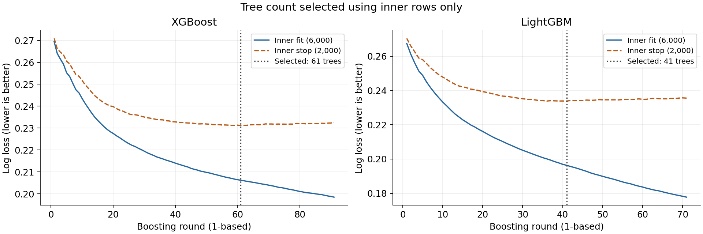

*The vertical markers show the selected tree counts. Log loss on the early-stopping set was lowest at 61 trees for XGBoost and 41 for LightGBM.* [Gate 1 technical report](reports/DAY1_TECHNICAL_REPORT.md)

### Interpretation and limitations

Although the development and comparison sets contain distinct applications, 1,226 customers appear in both sets. This overlap motivated the Gate 2 test on later applications from customers excluded from training. At Gate 1, I identified stronger AP on later cohorts as the evidence needed to reconsider the XGBoost choice. Gate 5 later made the final selection using its own nested comparison. [Gate 1 reflection](artifacts/artifacts_Day1/day1_reflection.json)

## Gate 2 validation design and results

Of the 10,000 synthetic applications, 7.89% resulted in default within 90 days. The audit retained 22 application-time predictors and found no duplicate applications. I tested four validation setups to see how the information available at training time affected the results.

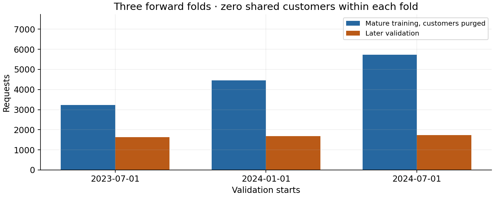

*The eligible training set grew from 3,223 to 5,731 applications as more 90-day outcomes became available. Each fold had zero shared customers between training and validation.* [Fold audit](artifacts/artifacts_Day2/fold_audit.csv)

| Validation setup | Applications evaluated | Mean ROC-AUC | Mean average precision (AP) |
| --- | ---: | ---: | ---: |
| Random folds, post-application fields and all-row imputation | 10,000 | 0.9999 | 0.9988 |
| Random folds, application-time predictors and training-fold imputation | 10,000 | 0.8010 | 0.3110 |
| Forward folds, separate customers, fixed 80 trees | 5,039 | 0.7976 | 0.3153 |
| Forward folds, separate customers, tuned model | 5,039 | 0.7855 | 0.3133 |

Each score is the mean across three folds. On identical random folds, mean AP fell by **0.6879** when I removed the two post-application fields and fitted the median imputer only on the training rows. The experiment changed both conditions together. Clean random validation scored **0.0044 lower** than the fixed model on the forward folds. That second comparison covers different applications, so the gap cannot be attributed to the split method alone. Both gaps use the unrounded scores. [Validation summary](artifacts/artifacts_Day2/validation_summary.csv) · [Per-fold metrics](artifacts/artifacts_Day2/validation_report.csv)


*The horizontal bars show one sample standard deviation across three folds. The fixed model had slightly higher mean AP (0.3153), while the tuned model varied less across the folds.*

For tuning, I reserved 1,935 earlier applications whose customers were absent from every outer validation fold. All eight Optuna trials ran on this pool. The best trial reached 0.3333 mean AP during tuning. On the 5,039 later applications, the fixed 80-tree model scored slightly higher than the tuned model (0.3153 versus 0.3133 AP). Both models produced one out-of-fold prediction per eligible application. The other 4,961 applications belonged to the initial historical period. [Trial history](artifacts/artifacts_Day2/optuna_results.csv) · [Out-of-fold coverage](artifacts/artifacts_Day2/day2_oof_coverage.csv) · [Gate 2 technical report](reports/DAY2_TECHNICAL_REPORT.md)


*The second trial reached the highest mean AP (0.3333) on the three tuning folds. The dashed line tracks that best score through the remaining trials.*

## Gate 3 review policy and results

The Gate 3 run produced out-of-fold (OOF) scores for 5,039 later applications, including 384 defaults (7.62%). Each validation fold uses a model trained on earlier applications with mature 90-day outcomes and no customers shared with that fold's validation set. Class weighting and oversampling affect training only; the validation applications retain their observed default rate. [Fold audit](artifacts/artifacts_Day3/artifacts/day3_provenance.json) · [Prediction coverage](artifacts/artifacts_Day3/artifacts/day3_oof_coverage.csv)

| Training strategy | Pooled ROC-AUC | Pooled AP | Recall at 0.5 | Flags at 0.5 | Within every period's capacity at 0.5? |
| --- | ---: | ---: | ---: | ---: | --- |
| Unweighted | 0.7979 | 0.3091 | 12.50% | 87 | Yes |
| Weighted | 0.7969 | 0.3100 | 57.81% | 1,005 | No |
| Oversampled | 0.7979 | 0.3159 | 59.90% | 1,047 | No |

The weighted strategy was declared before comparison for the threshold exercise. The threshold analysis follows that predeclared choice. Oversampling had the highest pooled AP in this run. These pooled scores use the same 5,039 applications and differ from Gate 2's means across folds. [Strategy comparison](artifacts/artifacts_Day3/artifacts/day3_model_comparison.csv)

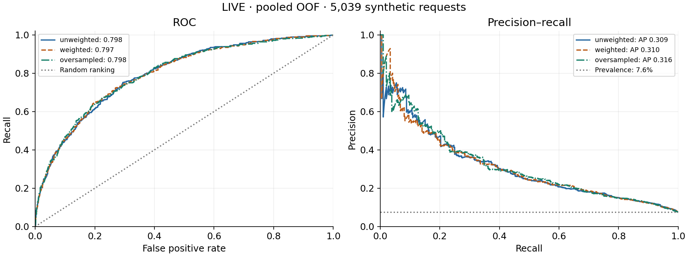

The selected rule flags an application when its weighted score is **greater than or equal to 0.6583471436014694**. It minimizes the observed loss among the tested thresholds that satisfy the capacity limit in every period. The JSON keeps the full-precision threshold and the comparison operator. [Exact decision rule](artifacts/artifacts_Day3/artifacts/threshold_metrics.json)

| Weighted-model rule | Threshold | Flagged applications | Recall | Precision | Loss units | Within capacity? |
| --- | ---: | ---: | ---: | ---: | ---: | --- |
| Default | 0.5000 | 1,005 (19.94%) | 57.81% | 22.09% | 2,403 | No |
| Minimum loss without capacity limit | 0.4486 | 1,141 (22.64%) | 64.06% | 21.56% | 2,275 | No |
| Minimum loss within every period's capacity | 0.6583 | 526 (10.44%) | 40.89% | 29.85% | 2,639 | Yes |

Thresholds in the table are rounded for display. The selected rule catches 157 defaults, misses 227, and incorrectly flags 369 non-defaulting applications. Its loss is `10 * 227 + 369 = 2,639` teaching units. Meeting capacity raises loss by 236 units relative to the default threshold and by 364 units relative to the unconstrained minimum. [Operating points](artifacts/artifacts_Day3/artifacts/threshold_metrics.json) · [Threshold sweep](artifacts/artifacts_Day3/artifacts/threshold_sweep.csv)

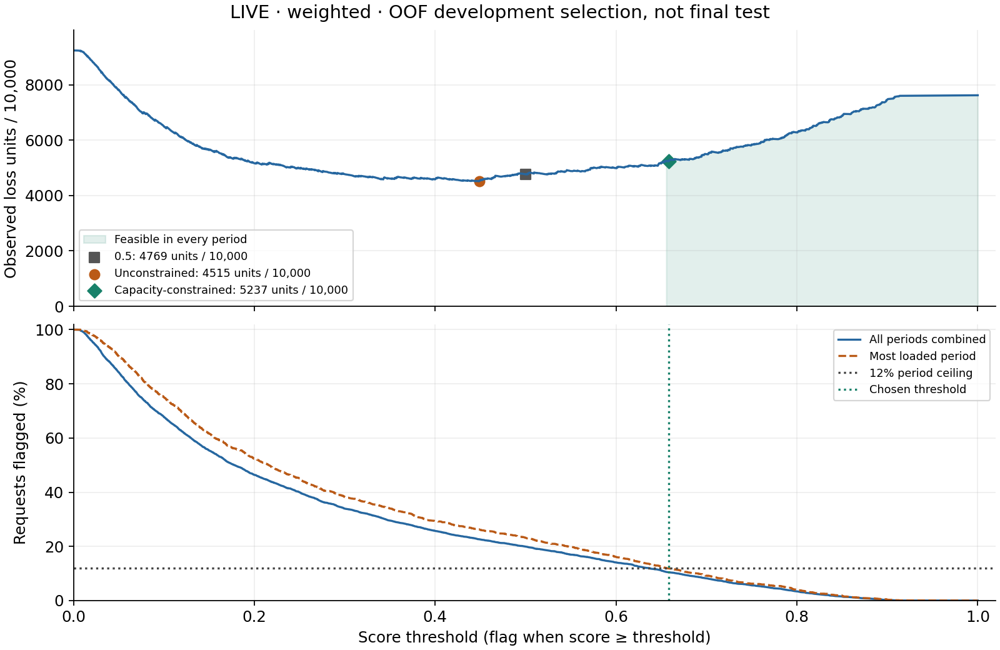

| Validation period | Applications | Review capacity, rounded down | Flagged | Flagged fraction |
| --- | ---: | ---: | ---: | ---: |
| July-December 2023 | 1,632 | 195 | 137 | 8.39% |
| January-June 2024 | 1,674 | 200 | 183 | 10.93% |
| July-December 2024 | 1,733 | 207 | 206 | 11.89% |

Every period stays within its own limit. A pooled flagged fraction below 12% would not, by itself, establish this. [Period audit](artifacts/artifacts_Day3/artifacts/day3_period_capacity.csv)

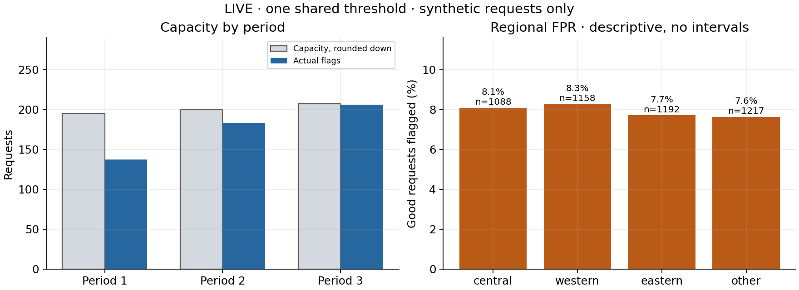

Regional false-positive rates range from 7.64% in other to 8.29% in western, a gap of 0.6484 percentage points. The comparison has no confidence intervals and does not establish fairness. Regional recall also varies, from 34.62% to 48.15%. The threshold was selected using these OOF development outcomes, so its loss needs confirmation on untouched later applications. All costs are teaching units and all applications are synthetic. [Regional audit](artifacts/artifacts_Day3/artifacts/day3_region_audit.csv) · [Completed reflection](artifacts/artifacts_Day3/artifacts/day3_reflection.json) · [Gate 3 technical report](reports/DAY3_TECHNICAL_REPORT.md)

## Gate 4 explanations and calibration

The Gate 4 workflow separates model fitting, calibration, policy selection and evaluation by time and customer. The evaluation role contains 1,733 applications from 1,520 customers, with 139 defaults (8.02%), dated July-December 2024. The model, sigmoid calibrator and policy threshold were frozen before this evaluation. The notebook explicitly records prior course exposure, so this is a held-out evaluation within Gate 4, not an untouched final test across the course. [Executed notebook](notebooks/Tamweel_aljuharaalshagri.ipynb)

| Data role | Applications | Customers | Defaults | Application dates |
| --- | ---: | ---: | ---: | --- |
| Model fitting | 2,516 | 1,853 | 217 | January 2022-April 2023 |
| Calibration | 584 | 538 | 40 | July-September 2023 |
| Policy selection | 589 | 566 | 55 | January-March 2024 |
| Evaluation | 1,733 | 1,520 | 139 | July-December 2024 |

### Global and local explanations

`bureau_score` and `dti` led both importance analyses. Permuting them reduced evaluation AP by 0.1270 and 0.0690. Their mean absolute SHAP contributions across the 300 sampled evaluation requests were 0.9042 and 0.5437 log-odds. SHAP decomposes the raw model margin; these values are not probability-point changes.

#### Permutation importance

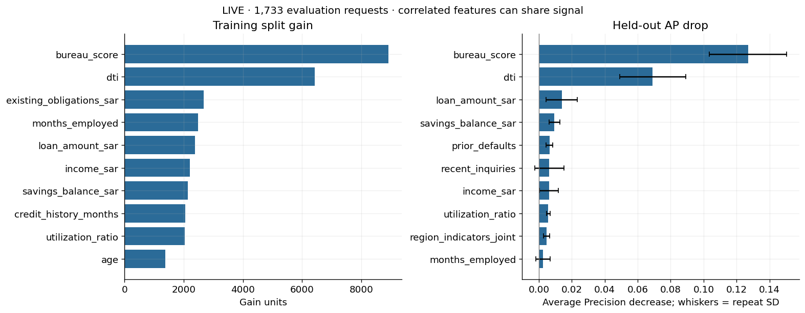

*Training gain is shown beside the decrease in evaluation average precision after shuffling each feature or group. Whiskers show repeat standard deviation.*

#### Global SHAP beeswarm

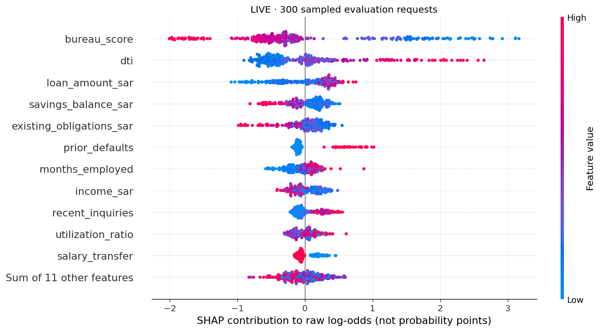

*Each dot represents a sampled evaluation request. Horizontal position shows the signed SHAP contribution in raw log-odds; color represents the feature value.*

#### Local SHAP waterfall

For `TR-009585`, the highest-scoring request within the SHAP sample, the leading positive contributions were `bureau_score` (+2.2693), `dti` (+1.1981) and `loan_amount_sar` (+0.2007). Its raw score was 0.9031 and its calibrated probability was 0.4795. None of the three displayed reasons used an imputed value. These are explanations of the fitted model's behavior, with no causal or real-lending claim.

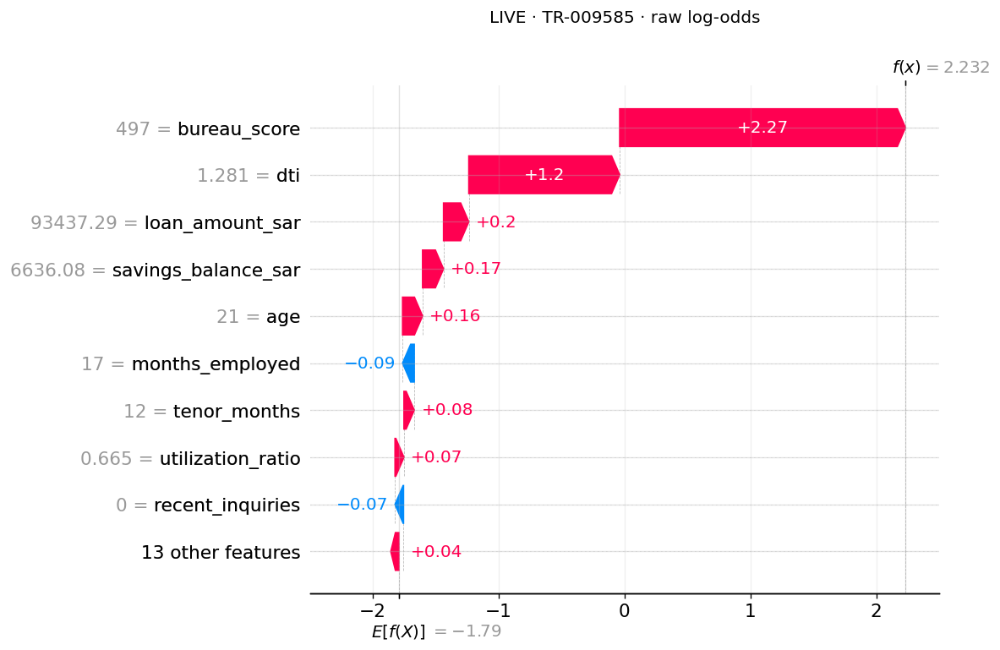

*The waterfall reconstructs the request's raw log-odds from the baseline and feature contributions. The calibrated probability is computed separately.*

### Probability calibration

| Metric on the evaluation role | Raw score | Sigmoid calibrated probability |
| --- | ---: | ---: |
| ROC-AUC | 0.770804 | 0.770804 |
| Average precision | 0.258677 | 0.258677 |
| Brier score | 0.113027 | 0.067112 |
| Expected calibration error | 0.146871 | 0.022486 |
| Log loss | 0.357993 | 0.246749 |

Calibration lowered all three reported probability-error measures and preserved the ranking metrics. Sparse reliability bins remain noisy. In 200 paired customer-cluster bootstrap replicates, the 95% interval for the Brier change after calibration was [-0.054177, -0.037409]. These intervals hold the fitted model and calibrator fixed. [Calibration metrics](artifacts/artifacts_Day4/artifacts/calibration_metrics.json) · [Bootstrap intervals](artifacts/artifacts_Day4/artifacts/day4_stability_summary.json)

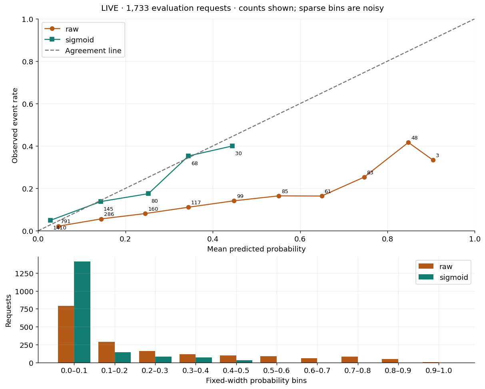

### Stability of the results

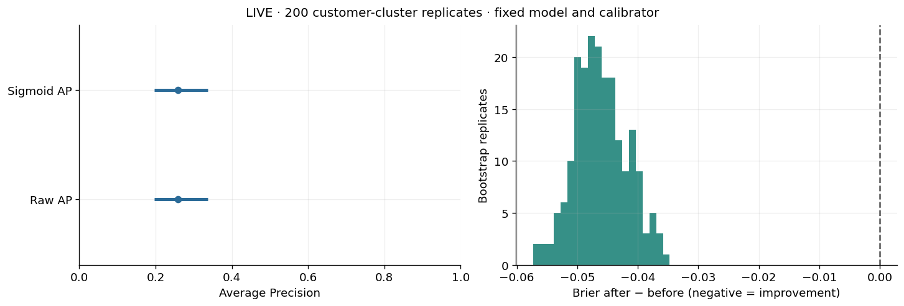

*The 200 customer-cluster bootstrap replicates keep the fitted model and calibrator fixed. The left panel shows the 95% AP intervals; the right panel shows the Brier change after calibration, where negative values indicate improvement.*

### Review capacity

The policy-selected raw threshold was approximately 0.588195, transported to approximately 0.17331 on the calibrated scale. These are displayed values, not substitutes for the full-precision runtime thresholds. The diagnostic review band extends 0.02 on either side of the calibrated threshold. The candidate queue is the union of risk flags and near-threshold requests, counting each application once.

| Evaluation period | Applications | Capacity | Risk flags | Near threshold | Candidate queue | Excess queue |
| --- | ---: | ---: | ---: | ---: | ---: | ---: |
| 2024Q3 | 836 | 100 | 97 | 23 | 109 | 9 |
| 2024Q4 | 897 | 107 | 109 | 21 | 122 | 15 |

The recorded status is `CAPACITY_REVIEW_REQUIRED`. Q4's risk flags alone also exceed capacity by two applications, so removing the diagnostic band would not resolve every breach. A revised policy needs selection on development or policy data and assessment on a new held-out period. The current evaluation set must not be reused for retuning.

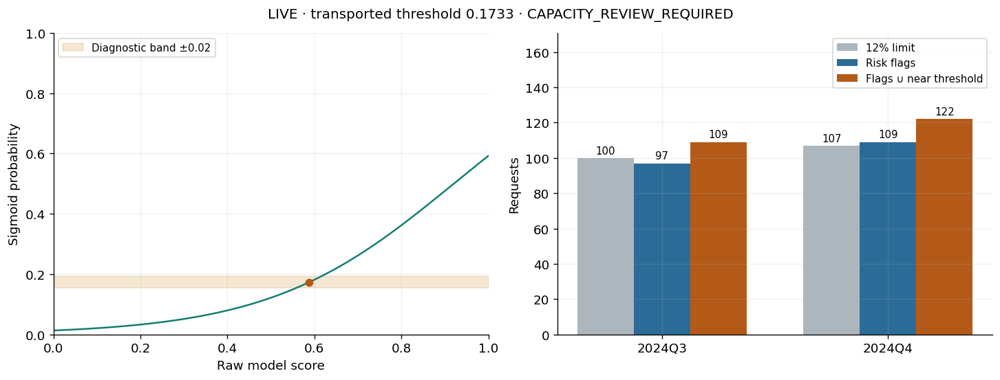

The reflection returned `READY_FOR_REVIEW` with no missing fields. The export printed `TECHNICAL_READY | READY_FOR_REVIEW | LIVE | CPU`, alongside `CAPACITY_REVIEW_REQUIRED`. The readiness labels describe completed educational work; they do not indicate capacity acceptance or deployment approval. [Completed reflection](artifacts/artifacts_Day4/artifacts/day4_reflection.json)

## Gate 5 final model and review policy

Gate 5 selected the single Logistic Regression model. It achieved the highest mean AP across three forward periods, while the weighted ensemble had slightly lower fold variability and ECE. The recorded gate decision is `KEEP SINGLE`, with candidate `Logistic`. This choice uses a different validation cohort and procedure from Gate 1; the scores should not be read as a direct performance trend across gates. [Candidate comparison](artifacts/artifacts_Day5/ensemble_comparison.csv)

### Data roles and validation

| Data role | Applications | Customers | Defaults | First application | Last application |
| --- | ---: | ---: | ---: | --- | --- |
| Fitting and selection | 6,576 | 3,931 | 537 | 2022-01-01 | 2024-04-01 |
| Calibration only | 836 | 788 | 78 | 2024-07-01 | 2024-09-30 |

The role split excludes 2,588 rows. The nested comparison produced `LIVE` OOF predictions for 2,155 applications across three forward periods. Warm-up applications have no outer OOF prediction. The design separates inner ensemble fitting from outer scoring and addresses chronology, customer separation and 90-day label availability. Candidate selection and threshold selection use this OOF evidence, so the results still need an untouched later evaluation. Fold SD describes variation across three folds; it is not a confidence interval. [Data roles](artifacts/artifacts_Day5/day5_roles.csv) · [Outer and inner fold provenance](artifacts/artifacts_Day5/day5_oof_provenance.json)

| Outer validation period | Training applications | Validation applications | Inner forward folds | Shared customers across the outer split |
| --- | ---: | ---: | ---: | ---: |
| January-March 2023 | 1,962 | 732 | 1 | 0 |
| July-September 2023 | 3,260 | 734 | 3 | 0 |
| January-March 2024 | 4,618 | 689 | 5 | 0 |

Within each outer training set, inner forward OOF predictions supply the data for a 12-point weighted-averaging search and for fitting the Logistic stacking model. The base models are then fitted on the outer training rows, and all six candidates are scored on the outer validation rows. Both levels enforce chronology, label maturity, and customer separation. This separation protects outer scoring from direct ensemble fitting, while the later use of outer scores for selection still limits the final performance claim. [Nested comparison implementation](scripts/day5_final.py) · [OOF predictions](artifacts/artifacts_Day5/day5_oof_predictions.csv) · [Fold scores](artifacts/artifacts_Day5/day5_fold_scores.csv)

### Single model and ensemble comparison

| Candidate | Mean AP | Fold SD of AP | Mean Brier | Mean ECE | AP difference from best single |
| --- | ---: | ---: | ---: | ---: | ---: |
| LightGBM | 0.34549 | 0.04348 | 0.06608 | 0.02311 | -0.04617 |
| XGBoost | 0.35263 | 0.02904 | 0.06566 | 0.02276 | -0.03903 |
| Logistic Regression | 0.39166 | 0.02981 | 0.06327 | 0.01882 | 0.00000 |
| Equal averaging | 0.37170 | 0.03258 | 0.06435 | 0.02038 | -0.01996 |
| Weighted ensemble | 0.38942 | 0.02906 | 0.06332 | 0.01772 | -0.00224 |
| Stacking | 0.38314 | 0.02949 | 0.06603 | 0.03106 | -0.00852 |

The probability scores in this table use raw OOF predictions before the final sigmoid mapping. No ensemble passed the worth-it gate. Weighted was the closest on AP, but its score was lower by 0.00224 and its Brier score was marginally higher. Its small SD and ECE advantages did not provide an AP gain to justify maintaining several models and a combination step. The differences do not establish statistical superiority. [Full comparison](artifacts/artifacts_Day5/ensemble_comparison.csv)

The implemented ensemble gate requires an AP lift over the best single model that exceeds that single model's fold SD, while allowing at most 0.005 higher mean Brier and 0.01 higher mean ECE. If several ensembles pass, the predeclared order is Equal, Weighted, then Stack. Every ensemble's AP change was negative here, so all failed the AP requirement. This is a course selection rule, not a statistical significance test. [Exact gate](artifacts/artifacts_Day5/day5_ensemble_gate.json)

The comparison and final fitting code train multiple base models internally. The exported artifact contains only the selected Logistic model, its fitted imputer and scaler, the 22-feature order, and the sigmoid mapping. The simplicity advantage therefore concerns the exported prediction procedure, explanation work, and maintenance; it does not mean the recorded experiment avoided fitting the other candidates. [Exported model](artifacts/final_model/model.json) · [Selection report](reports/ENSEMBLE_DECISION.md)

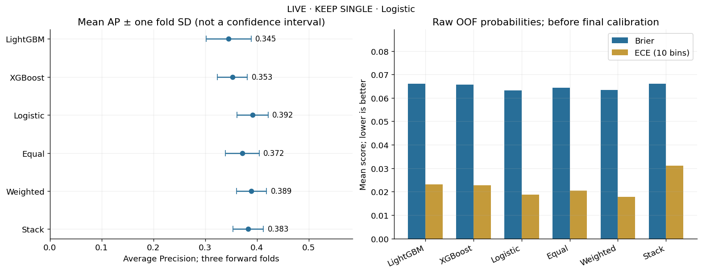

*The AP whiskers show one fold SD across three forward periods. Brier and ECE are lower-is-better scores; the plot precedes final calibration.*

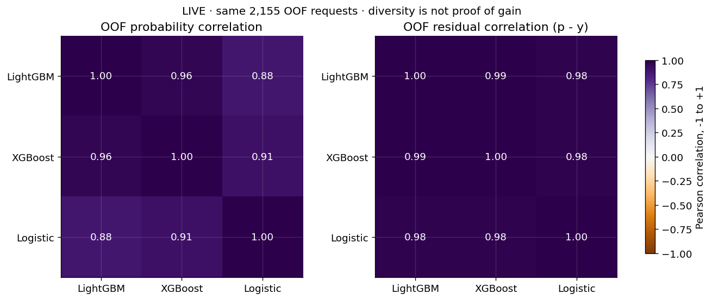

*The displayed probability correlations range from 0.88 to 0.96, while residual correlations range from 0.98 to 0.99. These rounded plot labels suggest substantial shared prediction behavior, but correlation alone does not determine whether an ensemble will improve AP.* [Probability correlations](artifacts/artifacts_Day5/day5_probability_correlation.csv) · [Residual correlations](artifacts/artifacts_Day5/day5_residual_correlation.csv)

### OOF threshold and regional diagnostics

The selected raw threshold is `0.16892161427109176`. At this threshold, 245 of 2,155 OOF applications are flagged, approximately 11.37%. The maximum flagged fraction in any forward period is approximately 11.75%, below the 12% limit. The operating point contains 84 true positives, 161 false positives, 95 false negatives and 1,815 true negatives. Recall is 46.93%, precision is 34.29%, and the false-positive rate is 8.15%. The educational loss is `10 * 95 + 161 = 1,111`. These figures describe the threshold selected on OOF development outcomes. [OOF operating point](artifacts/artifacts_Day5/final_metrics.json) · [Exact threshold metadata](artifacts/artifacts_Day5/final_policy.json) · [Period capacity](artifacts/artifacts_Day5/day5_period_capacity.csv)

| Region | Negative cases | Positive cases | False positives | True positives | FPR | Recall |
| --- | ---: | ---: | ---: | ---: | ---: | ---: |
| Central | 489 | 48 | 39 | 24 | 7.98% | 50.00% |
| Western | 486 | 47 | 50 | 21 | 10.29% | 44.68% |
| Eastern | 507 | 35 | 32 | 16 | 6.31% | 45.71% |
| Other | 494 | 49 | 40 | 23 | 8.10% | 46.94% |

FPR divides false positives by actual negative cases; recall divides true positives by actual positive cases. The largest FPR gap is approximately 3.98 percentage points between western and eastern. Each region contains only 35-49 positives, and the table includes no confidence intervals. These are OOF threshold diagnostics and do not establish fairness or describe the challenge batch after its cap. [Regional audit](artifacts/artifacts_Day5/day5_region_audit.csv)

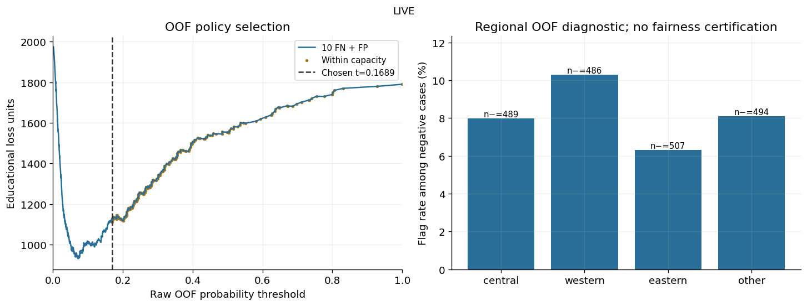

At the same fixed threshold, loss is 921, 1,111 and 1,301 teaching units when false-negative cost is 8, 10 and 12, respectively. The false-positive cost remains 1. These are sensitivity calculations for a fixed decision rule, not three independently optimized policies. [Cost sensitivity](artifacts/artifacts_Day5/day5_cost_sensitivity.csv)

### Calibration of the final model

The final classifier is refitted on the 6,576 fitting and selection applications. A separate block of 836 applications, including 78 defaults, is used to fit the sigmoid mapping. The displayed diagnostics are scored on those same calibration-fit rows. Holding them out from classifier fitting does not make them an independent test of the calibration mapping.

| Metric on calibration-fit rows | Raw probability | Sigmoid probability |
| --- | ---: | ---: |
| ROC-AUC | 0.789037 | 0.789037 |
| Average precision | 0.287803 | 0.287803 |
| Brier score | 0.076473 | 0.078058 |
| Log loss | 0.266489 | 0.277296 |
| ECE with 10 fixed-width bins | 0.021121 | 0.034871 |

All three probability-error scores worsen after sigmoid calibration, while the ranking metrics remain unchanged. The notebook nevertheless freezes and exports the mapping. These results do not support a calibration benefit; the mapping needs comparison on a separate later labeled cohort before deciding whether to retain it. [Calibration diagnostics](artifacts/artifacts_Day5/final_metrics.json) · [Calibration predictions](artifacts/artifacts_Day5/day5_calibration_predictions.csv)

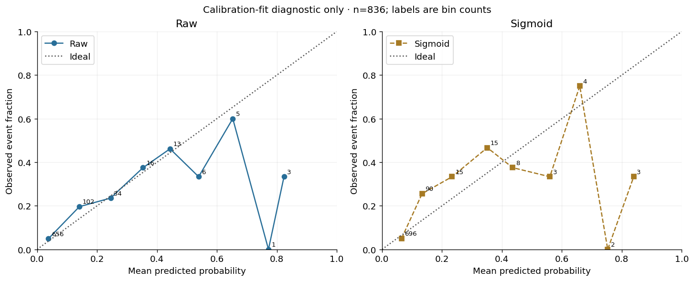

*Both panels use the rows that fitted the sigmoid mapping. Bin labels are counts, and sparse bins limit precision.*

### Challenge batch and capacity

The raw policy threshold is transported through the fitted mapping to `0.12225843144286948`. The notebook applies the threshold, then orders eligible requests by probability and applies the 12% cap once to all 2,500 requests. Equal-score blocks are retained together; a boundary block is dropped if it cannot fit. The policy does not use outcomes or application IDs to break ties. [Full batch audit](artifacts/artifacts_Day5/final_policy.json)

| Batch measure | Requests |
| --- | ---: |
| Full challenge batch | 2,500 |
| Threshold eligible | 330 |
| Capacity | 300 |
| Final flags | 300 |
| Removed by the cap | 30 |

Threshold eligibility is 13.2% of the batch, and the final flagged fraction is 12%. The saved boundary score is `0.12990841067105013`. The 30 removals were eligible under the fixed threshold but excluded by capacity; their outcomes are unknown. Challenge labels are unavailable, so the batch cannot provide measured recall, precision, calibration or outcome-based fairness. [Batch results](artifacts/artifacts_Day5/final_policy.json)

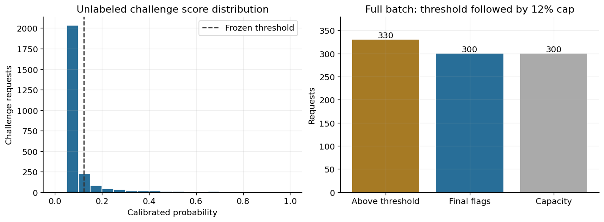

### Explanation scope and completion

Gate 4's explanations describe a weighted LightGBM fitted on 2,516 rows. They do not explain the final Logistic Regression refit on 6,576 rows. New explanations must use the frozen Logistic pipeline and its preprocessing, with checks of output units, additivity, reason codes, imputation and local stability. The sigmoid mapping and the threshold-plus-cap decision require separate checks. A model-score explanation alone does not explain a removal caused by the batch cap.

The current [combined notebook](notebooks/Tamweel_aljuharaalshagri.ipynb) contains 117 cells. Its saved reflection execution returns `READY_FOR_REVIEW | Missing: []`, and its later export cell records `REPLAY_MATCH` and `BUNDLE_BYTES_VERIFIED` for 48 files. The repository contains the full Gate 5 OOF table, the fitted model artifact, final policy, and complete submission, alongside the five figures. The runtime ZIP itself is not tracked. [Completed reflection](artifacts/artifacts_Day5/day5_reflection.json) · [Run record](artifacts/artifacts_Day5/day5_run.json) · [Submission manifest](submission/submission_manifest.json)

The same export records `PROJECT_WORK_REQUIRED`, and the later repository self-check records `NEEDS_WORK`. These results qualify the delivery status, even though the technical run and reflection are complete. The remaining requirements are described in [Delivery checks and remaining work](#delivery-checks-and-remaining-work). [Gate 5 technical report](reports/DAY5_TECHNICAL_REPORT.md)

## Repository structure

Repository filenames retain the original `day` and `DAY` spelling. Gate labels in this README describe the workflow without renaming those files.

| Location | Contents and purpose |
| --- | --- |
| [Combined notebook](notebooks/Tamweel_aljuharaalshagri.ipynb) | The single tracked notebook, with all five gates, saved results, completed reflections, export verification, and the final repository self-check. |
| [Data](data/) | Clean training CSV, unlabeled challenge CSV, data contract, and release manifest. |
| [Gate 1 archive](artifacts/artifacts_Day1/) | Model comparison, held-out predictions, split assignments, learning curves, and run and reflection records. |
| [Gate 2 archive](artifacts/artifacts_Day2/) | Leakage and fold audits, validation scores, tuning history, OOF predictions, and provenance. |
| [Gate 3 archive](artifacts/artifacts_Day3/artifacts/) | Strategy comparison, full OOF predictions, exact threshold and sweep, period and regional audits, reflection, and figures. |
| [Gate 4 archive](artifacts/artifacts_Day4/artifacts/) | Predictions, fitted booster, SHAP arrays and metadata, permutation importance, calibration and bootstrap results, capacity diagnostics, reflection, and six figures. |
| [Gate 5 archive](artifacts/artifacts_Day5/) | Candidate and fold scores, OOF predictions, roles and provenance, calibration predictions, final policy and model, reflection, project check, and five figures. |
| [Runtime artifacts](artifacts/) | Flat output files used by the delivery scripts, alongside the gate archives. Some earlier archived and flat files record different executions. |
| [Final model](artifacts/final_model/) | Frozen Logistic parameters and preprocessing, sigmoid mapping, and model manifest. |
| [Submission CSV](submission/submission.csv) and [manifest](submission/submission_manifest.json) | 2,500 unique application IDs, probabilities, and decisions; associated file and execution metadata. |
| [Inference entry point](scripts/inference.py) | `predict(frame, artifact_dir=None)` for probabilities from the exported artifact. The batch decision policy is applied separately. |
| [Replay script](scripts/replay_final.py) and [rebuild script](scripts/rebuild_final.py) | Reproduce saved predictions and decisions from frozen artifacts, or rebuild the pipeline from the recorded configuration. |
| [Gate 2 implementation](scripts/day2_validation.py), [Gate 3 implementation](scripts/day3_decision.py), [Gate 4 implementation](scripts/day4_trust.py), and [Gate 5 implementation](scripts/day5_final.py) | Modeling, validation, calibration, explanation, and policy helpers. |
| [Delivery helpers](scripts/day5_delivery.py) | Bundle creation, file manifests, project checks, and replay support. |
| [Requirements](requirements-colab.txt) and [constraints](constraints.txt) | Pinned numerical, modeling, plotting, and explanation dependencies. |
| [Repository self-check](tamweel_lite_self_check.json) | Saved status and file-level findings from the final repository inspection. |

### Technical reports and decision records

| Report | Coverage |
| --- | --- |
| [Gate 1 technical report](reports/DAY1_TECHNICAL_REPORT.md) | Baseline experiment, model choice, training behavior, and random-split limitations. |
| [Gate 2 technical report](reports/DAY2_TECHNICAL_REPORT.md) | Leakage controls, forward validation, historical tuning, and OOF coverage. |
| [Gate 3 technical report](reports/DAY3_TECHNICAL_REPORT.md) | Threshold selection, error costs, review capacity, and regional diagnostics. |
| [Gate 4 technical report](reports/DAY4_TECHNICAL_REPORT.md) | Explanations, calibration, stability, and the observed capacity warning. |
| [Gate 5 technical report](reports/DAY5_TECHNICAL_REPORT.md) | Final model choice, nested validation, calibration limits, batch policy, and delivery status. |
| [Decision card](reports/DECISION_CARD.md) | Gate 3 operating policy. |
| [Interpretability report](reports/INTERPRETABILITY_REPORT.md) | Gate 4 explanation and calibration record. |
| [Ensemble decision](reports/ENSEMBLE_DECISION.md) | Final single-versus-ensemble selection. |
| [Model card](reports/MODEL_CARD.md) | Final artifact, intended use, evidence, and limitations. |

The tracked technical reports are Markdown files. This inventory links only to files or directories present in the reviewed repository snapshot.

## Reproducing the results

### Review or run the combined notebook

1. Open the [executed notebook](notebooks/Tamweel_aljuharaalshagri.ipynb) to inspect the saved outputs, or use the [Colab link](https://colab.research.google.com/github/aljuharaalshagri/Tamweel_SDAIA_AdvanceML/blob/main/notebooks/Tamweel_aljuharaalshagri.ipynb) to run the current GitHub version.
2. Select a CPU runtime and run each gate in order, starting with its setup cells. The recorded configuration uses `FAST_MODE = True`, `FULL_MODE = False`, `SEED = 211`, and `N_JOBS = 2`. The setup verifies pinned course sources and downloads supporting files, so a complete notebook rerun requires network access.
3. If package installation restarts the session, reconnect and rerun from setup. The captured environment uses Python `3.13.18`; the supplied constraints describe Python 3.12 or 3.13 compatibility. Preserve the pinned dependencies when comparing results. [Recorded environment](artifacts/artifacts_Day5/environment.json)
4. Retain the documented experimental settings: the weighted strategy for Gate 3, `USE_SHAP_EXAMPLE = False` for Gate 4, and `USE_OOF_EXAMPLE = False` for Gate 5. Inspect `LIVE` provenance and OOF coverage before interpreting an output as this project's measured result.
5. Review calibration, regional denominators, and period or batch capacity before reading the readiness labels. Gate 4's capacity warning and Gate 5's calibration deterioration are observed findings, not errors to hide.
6. Run the reflection and export cells after their preceding computations. Import earlier gate exports when the bundle checker requests them, then inspect the reported completeness findings. A replay match verifies prediction reproduction; it does not resolve a missing delivery file.

The notebook writes flat runtime artifacts under `artifacts/`. The repository additionally preserves gate-specific archive folders. Repeated runs can change timing measurements and overwrite flat outputs; compare each numerical claim with its linked run record.

### Replay the frozen final procedure locally

From the repository root, in a compatible Python environment, the tracked commands are:

```bash
python -m pip install -r requirements-colab.txt -c constraints.txt
python scripts/replay_final.py
```

The replay script loads the frozen model and policy, scores the complete challenge batch, and compares every saved probability and decision by application ID. It expects probability agreement within `1e-12` absolute tolerance and exact decision agreement, printing `REPLAY_MATCH` on success. These are the script's checks; the documentation review did not execute them again. [Replay implementation](scripts/replay_final.py) · [Batch replay helper](scripts/day5_delivery.py)

For a full training and selection rebuild, the separate entry point is:

```bash
python scripts/rebuild_final.py
```

This script repeats the recorded fitting, nested candidate comparison, selection, thresholding, calibration, and full-batch decisions. It writes reconstructed model artifacts under `rebuild_check/final_model/` and checks probabilities within `1e-9` absolute tolerance plus exact decisions. Its result must be read from the new execution; the saved notebook replay is not evidence that this full rebuild has been rerun. [Rebuild implementation](scripts/rebuild_final.py)

### Score and apply the policy as separate operations

The `predict(frame, artifact_dir=None)` function in [scripts/inference.py](scripts/inference.py) returns application IDs and sigmoid-calibrated probabilities. Load the saved policy JSON and pass those predictions, `final_policy["calibrated_threshold"]`, and `CostPolicy(**final_policy["cost_policy"])` to `apply_batch_policy` in [scripts/day5_final.py](scripts/day5_final.py). That function receives the settings as arguments; it does not load the policy file itself. Assemble the complete intended batch before applying the cap. Applying the cap independently to chunks can change decisions, capacity rounding, and treatment of tied scores. The frozen threshold, mapping, costs, and batch audit are recorded in [final_policy.json](artifacts/final_policy.json).

## Delivery checks and remaining work

The repository contains substantial completed work, but its saved checkers require particular delivery layouts. Their findings should be read against those requirements.

The later [repository self-check](tamweel_lite_self_check.json) reports **13 failed checks**, representing **eight distinct missing expected paths**. Five missing gate notebooks also fail separate executed-notebook checks.

| Expected path | Recorded finding |
| --- | --- |
| `tamweel/__init__.py` | Missing expected package file. |
| `tamweel/inference.py` | Missing expected package entry point; the repository instead contains `scripts/inference.py`. |
| `notebooks/01_baseline_boosting.ipynb` | Missing expected separate Gate 1 notebook and its execution check. |
| `notebooks/02_validation_tuning.ipynb` | Missing expected separate Gate 2 notebook and its execution check. |
| `notebooks/03_cost_sensitive_decision.ipynb` | Missing expected separate Gate 3 notebook and its execution check. |
| `notebooks/04_explain_calibrate.ipynb` | Missing expected separate Gate 4 notebook and its execution check. |
| `notebooks/05_final_model.ipynb` | Missing expected separate Gate 5 notebook and its execution check. |
| `notebooks/99_final_submission_check.ipynb` | Missing expected final-check notebook. |

The executed combined notebook is present, as are the inference script and earlier gate archives. These findings concern the checker's expected paths and organization; they do not mean that all of the corresponding analysis is absent.

The earlier [export-time project check](artifacts/artifacts_Day5/day5_project_check.json) separately expected imported evidence under `evidence/day1` through `evidence/day4`, five template-named notebooks, and `presentation/final_presentation.pdf`. It recorded `PROJECT_WORK_REQUIRED` and no receipt. The later repository self-check uses a different expected-file list and does not request that presentation. The two checks therefore describe different scopes and stages of delivery.

The remaining delivery task is to align the executed evidence and inference interface with the applicable submission layout, preserve the original outputs and provenance, and rerun the relevant completeness checks. Any new status should come from that execution. Updating this README does not change the recorded check results. [Submission metadata](submission/submission_manifest.json)

## Intended use and limitations

This capstone is for fictional training, method comparison, and reproducible coursework. It studies ranking and review allocation on synthetic applications. It must not be used for real loan approval, rejection, pricing, credit limits, or customer-facing adverse-action reasons. The observations are not evidence about actual borrowers or regions. [Data restrictions](data/data_contract.json) · [Model card](reports/MODEL_CARD.md)

The main evidence limits are:

- **Selection reuse:** Gate 5's outer OOF results informed both model and threshold selection. No untouched labeled final cohort measures the whole selected procedure.
- **Calibration scope:** Gate 4's improvement belongs to its weighted LightGBM and its evaluation role. Gate 5's sigmoid diagnostics use calibration-fit rows and worsen all three reported probability-error measures.
- **Explanation scope:** The existing SHAP and permutation results describe the Gate 4 model. The final Logistic pipeline needs its own checked explanations, and the batch cap needs a separate decision explanation.
- **Regional uncertainty:** OOF regional outcomes have limited positive counts and no reported regional confidence intervals. Challenge outcomes are unknown, so post-cap outcome fairness cannot be measured there.
- **Operational scope:** A full-batch 12% cap controls workload for that batch. It does not establish a real review service's staffing needs or the consequences of delaying an eligible request.
- **Delivery status:** Saved replay verification and completed reflections coexist with outstanding project-layout checks. They establish different parts of the coursework record.

These limitations follow from the [OOF provenance](artifacts/artifacts_Day5/day5_oof_provenance.json), [calibration and threshold metrics](artifacts/artifacts_Day5/final_metrics.json), [regional audit](artifacts/artifacts_Day5/day5_region_audit.csv), [batch policy](artifacts/artifacts_Day5/final_policy.json), and [repository self-check](tamweel_lite_self_check.json).

## Monitoring plan

The following is a proposed plan for future controlled experiments. This repository does not demonstrate an operating monitoring service.

| Timing | Checks | Follow-up |
| --- | --- | --- |
| Before scoring each batch | Schema, feature availability, data types, missingness, duplicate application IDs, feature distributions, and score drift against the development reference. | Investigate input changes; preserve the model version and batch identity with each result. |
| When applying the policy | Batch size, threshold eligibility, final flags, cap removals, tied-score handling, and compliance with `floor(0.12 * batch_size)`. | Reconcile the complete batch and record why eligible requests were removed. |
| For each region | Application counts, selection rates, threshold eligibility, and cap-removal rates with explicit denominators. | Investigate uneven patterns without treating selection parity as proof of outcome fairness. |
| After 90-day labels mature | Default prevalence, AP, recall, precision, teaching loss, Brier, log loss, ECE, and reliability-bin counts; regional FPR and recall with uncertainty estimates. | Compare with an appropriate earlier reference and review deterioration on a fresh labeled cohort. |
| Before accepting an update | Later-period evaluation of the complete model, calibrator, and policy; refreshed explanation checks and replay verification. | Version the change and retain its evidence. Do not retune on a period still described as an untouched evaluation. |

Numerical drift-alert limits were not established by this experiment. They should be selected and assessed using the intended monitoring data. The capacity limit is already explicit; the other alerts require their own empirical justification. The plan extends the completed [Gate 5 reflection](artifacts/artifacts_Day5/day5_reflection.json) and the frozen [cost and capacity policy](artifacts/final_policy.json).

## Daily answers | الإجابات اليومية

### Day 1 | اليوم الأول

**1. Is your environment ready, with no errors shown in red?**

Yes. The saved Day 1 section completed its 11 code cells without errors. Its export cell saved the results and reported `TECHNICAL_READY` and `READY_FOR_REVIEW`. [Executed notebook](notebooks/Tamweel_aljuharaalshagri.ipynb)

**2. Which model did you choose, and what evidence supports your choice?**

I chose XGBoost because it had the highest average precision on the 2,000 held-out applications (0.3338), ahead of Logistic Regression (0.3258) and LightGBM (0.3248). Only 158 applications resulted in default (7.9%), so I prioritized how precisely the model identified defaults as recall increased. [Model scores](artifacts/artifacts_Day1/day1_model_comparison.csv)

### Day 2 | اليوم الثاني

**What leakage risk did you identify, and how did the validation design prevent it?**

I removed `days_past_due_60` and `collection_calls` because they record repayment behavior after submission. Using either field would give the model information a lender could not have when scoring the application.

For each forward fold, I trained only on earlier applications whose 90-day outcome window had closed before validation began. I also excluded every customer in that fold's validation set from its training set. The audit confirmed zero shared customers in all three folds. I selected hyperparameters using the separate historical tuning pool and froze them before outer evaluation. The challenge data played no role in parameter selection. [Feature audit](artifacts/artifacts_Day2/leakage_audit.csv) · [Fold audit](artifacts/artifacts_Day2/fold_audit.csv) · [Run record](artifacts/artifacts_Day2/day2_run.json)

### Day 3 | اليوم الثالث

**Why is a fixed threshold of 0.5 not always suitable for this review policy?**

A threshold of 0.5 does not account for this policy's unequal error costs or its review limit. Missing a default costs 10 teaching units, while incorrectly flagging a non-defaulting application costs 1 unit. Reviewers can handle at most 12% of applications in each period. The weighted model at 0.5 flags 1,005 of 5,039 applications (19.94%) and fails the capacity check, despite its lower loss of 2,403 units.

I therefore selected the threshold that minimizes observed loss while meeting capacity in every period: `score >= 0.6583471436014694`. It flags 526 applications, stays within all three period limits, and has a loss of 2,639 units. This choice accepts more missed defaults to keep the workload feasible. The weighted scores have not been established as calibrated probabilities, so neither 0.5 nor the theoretical cost-only threshold `1 / 11` can be assumed appropriate. The latter requires calibrated probabilities, this loss matrix and no capacity constraint. [Operating points](artifacts/artifacts_Day3/artifacts/threshold_metrics.json) · [Period audit](artifacts/artifacts_Day3/artifacts/day3_period_capacity.csv) · [Day 3 reflection](artifacts/artifacts_Day3/artifacts/day3_reflection.json)

### Day 4 | اليوم الرابع

#### 1 What is the difference between global and local explanations

Global importance summarizes behavior across applications. `bureau_score` and `dti` had the largest mean absolute SHAP contributions (0.9042 and 0.5437 log-odds) and the largest permutation AP drops (0.1270 and 0.0690). The local explanation describes one request, `TR-009585`, whose leading positive contributions were `bureau_score` (+2.2693), `dti` (+1.1981) and `loan_amount_sar` (+0.2007). The global ranking reports average magnitude; local signed values show how features move that request's raw score relative to its SHAP base value.

#### 2 What units do the SHAP outputs use

The contributions use raw log-odds. Adding all contributions to the base value reconstructs the raw margin; applying `expit` gives the raw probability. The separate calibration mapping produces the calibrated probability. For `TR-009585`, these probabilities were 0.9031 and 0.4795. The maximum additivity error was about 5.7e-15. The displayed SHAP values do not directly decompose the calibrated probability.

#### 3 What can the reason codes establish

The reason codes describe associations in a model trained on synthetic data. They do not establish causation, fairness or suitability for real lending. Correlated predictors can share signal. The three displayed reasons for `TR-009585` used observed values, with no imputation, but changing those values does not guarantee a particular real-world outcome.

#### 4 What evidence supports calibration

On 1,733 evaluation applications with 139 defaults, Brier score fell from 0.113027 to 0.067112, ECE from 0.146871 to 0.022486, and log loss from 0.357993 to 0.246749. AP remained 0.258677 and ROC-AUC remained 0.770804. The model, calibrator and threshold were frozen before the Day 4 evaluation. The evidence supports improved probability agreement in this period, with limited precision in sparse reliability bins.

#### 5 How stable are the results and explanations

The 200 paired customer-cluster bootstrap replicates gave a 95% AP interval of [0.197442, 0.337854] for both variants and a Brier-change interval of [-0.054177, -0.037409]. AP was 0.27457 in Q3 and 0.27050 in Q4. The intervals cover evaluation-sample variability with the model and calibrator fixed. They exclude retraining and future distribution changes. For the selected request, changing `bureau_score` from 497 to 496 or 498 left both probabilities and all three leading positive reasons unchanged. That is a narrow local check.

#### 6 Does the review zone fit capacity

No. The candidate review queue contains 109 requests against capacity 100 in Q3 and 122 against capacity 107 in Q4. Q4 risk flags alone total 109, so removing the near-threshold band would still leave a breach. The recorded status is `CAPACITY_REVIEW_REQUIRED`. I would revise the operating policy using designated development or policy data and test it on a new held-out period, without retuning on the current evaluation set. The band is a diagnostic score range, not an individual confidence interval.

The full responses are preserved in the [completed reflection](artifacts/artifacts_Day4/artifacts/day4_reflection.json).

#### Day 4 technical report

[Read the technical report](reports/DAY4_TECHNICAL_REPORT.md) 

The report develops these six answers with the experimental design, measured results, all six notebook figures, and a documented interpretation of the capacity warning.

### Day 5 final project

#### 1 Model selection

**Why did you choose the single model or the ensemble for the final project?**

I chose the single Logistic Regression model because it achieved the highest mean AP, 0.39166 with fold SD 0.02981. The weighted ensemble was closest at AP 0.38942 with SD 0.02906. Logistic had a slightly better raw OOF Brier score, 0.06327 versus 0.06332, while Weighted had lower ECE, 0.01772 versus 0.01882. No ensemble passed the worth-it gate. The small SD and ECE advantages did not justify adding several models without an AP gain. These differences support the choice made in this experiment, but do not prove statistical superiority. [Model comparison](artifacts/artifacts_Day5/ensemble_comparison.csv)

#### 2 Validation limits

The 2,155 LIVE OOF predictions cover three forward periods. The nested design separates inner ensemble fitting from outer scoring and addresses chronology, customer separation and mature 90-day labels. Warm-up rows have no outer OOF predictions. I used the outer results to select the candidate and threshold, so they remain selection evidence. Three folds and previously explored synthetic course data cannot replace an untouched later test. Fold SD is not a confidence interval, and the unlabeled challenge does not measure predictive performance. [Saved evidence](artifacts/artifacts_Day5/final_metrics.json)

#### 3 Calibration limits

The 836 calibration applications, with 78 positives, were held out from classifier fitting. The displayed sigmoid diagnostics nevertheless use the same rows that fitted the mapping. Brier worsened from 0.076473 to 0.078058, log loss from 0.266489 to 0.277296, and ECE from 0.021121 to 0.034871. AP and ROC-AUC stayed unchanged. I cannot claim a calibration benefit; the frozen mapping needs independent evaluation on a later labeled cohort. [Calibration diagnostics](artifacts/artifacts_Day5/final_metrics.json)

#### 4 Capacity and fairness

I applied the 12% cap once to the complete batch of 2,500 requests. It retained 300 of 330 threshold-eligible flags and removed 30 whose outcomes are unknown. Regional OOF FPR divides false positives by actual negatives: 39/489 in central, 50/486 in western, 32/507 in eastern and 40/494 in other. The largest FPR gap is about 3.98 percentage points. Recall uses actual positives, with only 35-49 per region. Capacity compliance does not establish fairness; selection and cap-removal patterns need regional checks, followed by outcome-based checks once labels mature. [Batch audit](artifacts/artifacts_Day5/final_policy.json) · [Regional audit](artifacts/artifacts_Day5/day5_region_audit.csv)

#### 5 Explanation scope

Day 4 explains a weighted LightGBM fitted on 2,516 rows. Day 5 refits Logistic Regression on 6,576 rows, so the earlier SHAP figures, importance rankings and reason codes do not explain this final model. I need a suitable explainer for the frozen Logistic pipeline and its preprocessing. I would recheck units, additivity, imputation, local reason codes and stability, then assess held-out permutation importance. Calibration and the threshold-plus-cap rule need separate checks. Model explanations do not establish causality or fairness.

#### 6 Intended use

This project ranks simulated 90-day default risk and examines review allocation using synthetic applications. The `10 * FN + FP` loss and 12% cap are teaching assumptions. The artifact is for coursework and reproducible experiments. It must not decide real loan approval, rejection, pricing or credit limits, or supply customer-facing adverse-action reasons.

#### 7 Monitoring plan

For each batch I would check schema, feature availability, missingness, duplicate IDs, feature distributions and score drift. I would record threshold eligibility, final flags and cap removals, enforce the full-batch 12% limit, and compare selection and removal rates by region. After 90-day labels mature, I would assess prevalence, AP, recall, precision, loss, Brier, log loss, ECE and reliability-bin counts. Regional outcome checks must show denominators and uncertainty. Any revised model, calibrator or policy needs assessment on fresh later data, and a refitted model needs updated explanations.

#### 8 Executive summary in Arabic

أختار الانحدار اللوجستي للمشروع التدريبي؛ فقد حقق أعلى متوسط AP بقيمة 0.39166 وانحراف معياري بين الطيات 0.02981، مقابل AP قدره 0.38942 للتجميع الموزون. لم يبرر التجميع زيادة التعقيد. طُبق سقف المراجعة بنسبة 12% على 2500 طلب، فبقيت 300 إشارة من أصل 330 فوق العتبة. تدهور Brier بعد المعايرة من 0.076473 إلى 0.078058، لذلك يلزم تقييم مستقل للمعايرة وإعادة تفسير النموذج النهائي. الاستخدام تعليمي ببيانات اصطناعية، ولا يشمل قرارات تمويل حقيقية.

#### 9 Executive summary in English

I selected Logistic Regression with mean AP 0.39166 and fold SD 0.02981, compared with AP 0.38942 for the weighted ensemble. No ensemble justified its added complexity. The full-batch 12% cap retained 300 of 2,500 requests and removed 30 of the 330 eligible flags. Sigmoid calibration worsened Brier from 0.076473 to 0.078058. Independent calibration evaluation and explanations for the final model are still needed. This artifact is restricted to fictional training use.

The nine answers are included in the [Day 5 reflection](artifacts/artifacts_Day5/day5_reflection.json) and the [combined notebook](notebooks/Tamweel_aljuharaalshagri.ipynb). The saved reflection execution returned `READY_FOR_REVIEW | Missing: []`. This records completion of the answer fields, while the project packaging checks still report outstanding items.

[Read the Day 5 technical report](reports/DAY5_TECHNICAL_REPORT.md) 

## Training-program attribution

This project is part of SDAIA Academy's Advanced Machine Learning program (SDA-DSC-211) with Mrs. Meaad Al-Marri. [SDAIA Academy](https://github.com/SDAIAAcademy)
