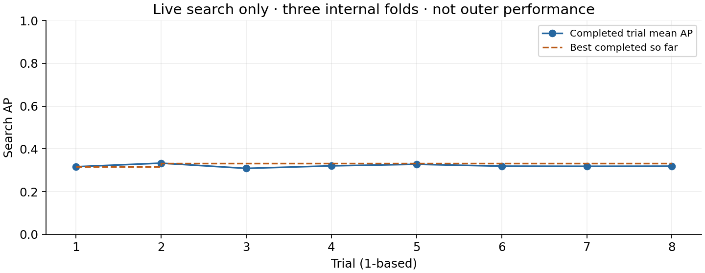

# Tamweel Lite

Tamweel Lite studies how well machine learning models can rank loan applications by the risk of default within 90 days. The project uses synthetic applications and information available at the time of submission.

**Author** Aljuhara Alshagri

**Program** Advanced Machine Learning (SDA-DSC-211), SDAIA Academy

| Day | Executed notebook | Open in Colab |
| --- | --- | --- |
| 1 | [Baseline model comparison](notebooks/01_baseline_boosting.ipynb) | [Run Day 1](https://colab.research.google.com/github/aljuharaalshagri/Tamweel_SDAIA_AdvanceML/blob/main/notebooks/01_baseline_boosting.ipynb) |
| 2 | [Day 1 baseline followed by Day 2 validation and tuning](notebooks/02_validation_tuning.ipynb) | [Run both days](https://colab.research.google.com/github/aljuharaalshagri/Tamweel_SDAIA_AdvanceML/blob/main/notebooks/02_validation_tuning.ipynb) |

## Project overview

Day 1 asks whether gradient boosting improves on a Logistic Regression baseline. I trained XGBoost and LightGBM alongside the baseline, then compared all three on the same 2,000 held-out applications. Each application has a score from every model, so the comparison uses the same outcomes throughout. [Held-out predictions](artifacts/day1_comparison_predictions.csv)

Day 2 tests whether LightGBM can rank default risk for later applications from customers excluded from training. I audited which fields were available at submission, set aside historical data for tuning, and compared random validation with three forward validation folds.

## Day 1 results

| Model | ROC-AUC | Average precision | Training time (s) |
| --- | ---: | ---: | ---: |
| Logistic Regression | **0.821** | 0.326 | 0.082 |
| XGBoost | 0.812 | **0.334** | 0.458 |
| LightGBM | 0.814 | 0.325 | 0.341 |

Logistic Regression led on ROC-AUC. XGBoost led on average precision, which matters here because only 158 of the 2,000 applications resulted in default (7.9%). Training times come from the archived Day 1 comparison CSV and include tree-count selection and refitting for the boosting models. The saved notebook shows timings from a separate CPU run with the same scores. [Full comparison table](artifacts/day1_model_comparison.csv)

*The dotted horizontal line in the precision-recall panel marks the 7.9% default rate. XGBoost had the highest average precision (0.3338).*

## Day 1 training pipeline

1. Select the 22 application-time predictors and reserve 2,000 of the 10,000 applications for comparison using a stratified random split.
2. Fit Logistic Regression on the 8,000 development applications after median imputation and feature scaling.
3. Within the development set, fit the boosting models on 6,000 applications and use the other 2,000 to select the tree count by log loss. XGBoost selected 61 trees and LightGBM selected 41.
4. Refit each boosting model on all 8,000 development applications at its selected tree count. Score all three models on the held-out applications and export the predictions, metrics and plots.

*The vertical markers show the selected tree counts. Log loss on the early-stopping set was lowest at 61 trees for XGBoost and 41 for LightGBM.* [Day 1 technical report](reports/DAY1_TECHNICAL_REPORT.md)

## Day 2 validation design and results

Of the 10,000 synthetic applications, 7.89% resulted in default within 90 days. The audit retained 22 application-time predictors and found no duplicate applications. I tested four validation setups to see how the information available at training time affected the results.

*The eligible training set grew from 3,223 to 5,731 applications as more 90-day outcomes became available. Each fold had zero shared customers between training and validation.* [Fold audit](artifacts/fold_audit.csv)

| Validation setup | Applications evaluated | Mean ROC-AUC | Mean average precision (AP) |
| --- | ---: | ---: | ---: |
| Random folds, post-application fields and all-row imputation | 10,000 | 0.9999 | 0.9988 |
| Random folds, application-time predictors and training-fold imputation | 10,000 | 0.8010 | 0.3110 |
| Forward folds, separate customers, fixed 80 trees | 5,039 | 0.7976 | 0.3153 |
| Forward folds, separate customers, tuned model | 5,039 | 0.7855 | 0.3133 |

Each score is the mean across three folds. On identical random folds, mean AP fell by **0.6879** when I removed the two post-application fields and fitted the median imputer only on the training rows. The experiment changed both conditions together. Clean random validation scored **0.0044 lower** than the fixed model on the forward folds. That second comparison covers different applications, so the gap cannot be attributed to the split method alone. Both gaps use the unrounded scores. [Validation summary](artifacts/validation_summary.csv) · [Per-fold metrics](artifacts/validation_report.csv)

*The horizontal bars show one sample standard deviation across three folds. The fixed model had slightly higher mean AP (0.3153), while the tuned model varied less across the folds.*

For tuning, I reserved 1,935 earlier applications whose customers were absent from every outer validation fold. All eight Optuna trials ran on this pool. The best trial reached 0.3333 mean AP during tuning. On the 5,039 later applications, the fixed 80-tree model scored slightly higher than the tuned model (0.3153 versus 0.3133 AP). Both models produced one out-of-fold prediction per eligible application. The other 4,961 applications belonged to the initial historical period. [Trial history](artifacts/optuna_results.csv) · [Out-of-fold coverage](artifacts/day2_oof_coverage.csv) · [Day 2 technical report](reports/DAY2_TECHNICAL_REPORT.md)

*The second trial reached the highest mean AP (0.3333) on the three tuning folds. The dashed line tracks that best score through the remaining trials.*

## Repository structure

| Location | Contents |
| --- | --- |
| [notebooks/](notebooks/) | The Day 1 notebook and the cumulative notebook with the Day 1 baseline followed by the Day 2 validation and tuning run |
| [artifacts/](artifacts/) | Day 1 model comparisons and Day 2 leakage audits, validation scores, tuning history, predictions, figures and run records |
| [Day 1 technical report](reports/DAY1_TECHNICAL_REPORT.md) | Day 1 model choice and evidence from the held-out comparison |
| [Day 2 technical report](reports/DAY2_TECHNICAL_REPORT.md) | Leakage controls, fold construction and results on later applications |

## Quick start

1. Open **Run both days** to run the Day 1 baseline and Day 2 validation in order in a single notebook. For the baseline alone, open **Run Day 1**. Select a CPU runtime. The recorded runs used the default fast mode.
2. Choose **Runtime > Run all**. If dependency installation restarts the session, reconnect and choose **Run all** again.
3. In Day 2, check for `Day 2 setup verified`. The notebook audits the features, constructs the folds, runs the reserved Optuna search, then evaluates the frozen settings. The submitted run completed eight trials and the reflection check returned `READY_FOR_REVIEW` with no missing answers. [Day 2 run](artifacts/day2_run.json) · [Completed reflection](artifacts/day2_reflection.json)
4. Each day has its own export cell. The combined notebook writes both `day1_artifacts.zip` and `day2_artifacts.zip` to `/content/tamweel/artifacts/` in Colab. The Day 2 environment record appears as `day2_environment.json` in this repository and as `environment.json` inside the exported ZIP.

## Dataset and models

The target, `default_within_90d`, records whether an application resulted in default within 90 days. Predictors include income in Saudi riyals and bureau score. Identifiers, dates and split-control fields are excluded from the model inputs. The recorded run used version `tamweel-lite-1.0` of the synthetic data and random seed `211`. [Environment](artifacts/environment.json) · [Run settings](artifacts/day1_run.json)

## Day 1 interpretation and limitations

Although the development and comparison sets contain distinct applications, 1,226 customers appear in both sets. This overlap motivated the Day 2 test on later applications from customers excluded from training. I would reconsider XGBoost if another model consistently achieved higher average precision on later cohorts. [Day 1 reflection](artifacts/day1_reflection.json)

## Daily answers | الإجابات اليومية

### Day 1 | اليوم الأول

**1. Is your environment ready, with no errors shown in red?**

Yes. All 11 Day 1 code cells in my saved notebook ran in order. The Day 1 export cell saved the results and reported `TECHNICAL_READY` and `READY_FOR_REVIEW`. [Executed notebook](notebooks/01_baseline_boosting.ipynb)

**2. Which model did you choose, and what evidence supports your choice?**

I chose XGBoost because it had the highest average precision on the 2,000 held-out applications (0.3338), ahead of Logistic Regression (0.3258) and LightGBM (0.3248). Only 158 applications resulted in default (7.9%), so I prioritized how precisely the model identified defaults as recall increased. [Model scores](artifacts/day1_model_comparison.csv)

### Day 2 | اليوم الثاني

**What leakage risk did you identify, and how did the validation design prevent it?**

I removed `days_past_due_60` and `collection_calls` because they record repayment behavior after submission. Using either field would give the model information a lender could not have when scoring the application.

For each forward fold, I trained only on earlier applications whose 90-day outcome window had closed before validation began. I also excluded every customer in that fold's validation set from its training set. The audit confirmed zero shared customers in all three folds. I selected hyperparameters using the separate historical tuning pool and froze them before outer evaluation. The challenge data played no role in parameter selection. [Feature audit](artifacts/leakage_audit.csv) · [Fold audit](artifacts/fold_audit.csv) · [Run record](artifacts/day2_run.json)

## Training-program attribution

This project is part of SDAIA Academy's Advanced Machine Learning program (SDA-DSC-211) with Mrs. Meaad Al-Marri. [SDAIA Academy](https://github.com/SDAIAAcademy) · [Day 2 submission guide](https://github.com/almiyead-rgb/sda-dsc-211-student-template/blob/main/DAY2_GUIDE.md)
