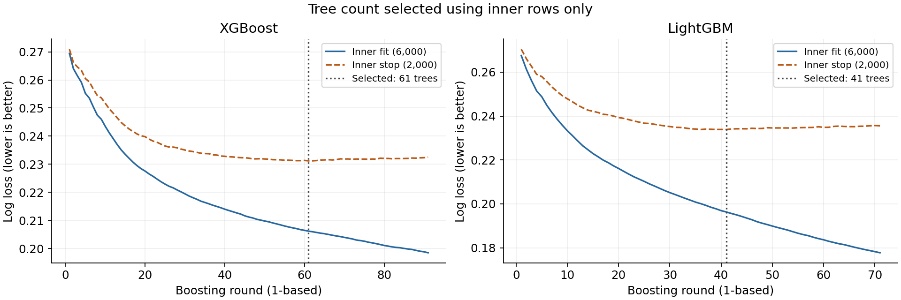

# Day 1 technical report

## Prediction question

At application time, how well can a model rank loan applications by the risk of default in the next 90 days? The dataset contained 10,000 synthetic Tamweel Lite applications. Each model used the same 22 application-time predictors. The outcome was `default_within_90d`. [Executed notebook](../notebooks/01_baseline_boosting.ipynb)

## Training and early stopping

I used a stratified random split and held out 2,000 applications for the final comparison. Within the 8,000 development applications, the boosting models used 6,000 for fitting and 2,000 for choosing the tree count. Log loss on those 2,000 rows favored 61 trees for XGBoost and 41 for LightGBM. I refit both models on all 8,000 development applications using those counts. The Logistic Regression baseline used median imputation and scaling. Holding the comparison rows aside kept their outcomes from influencing early stopping. [Split membership](../artifacts/day1_split_membership.csv) · [Run settings](../artifacts/day1_run.json)

## Choice of baseline

Of the 2,000 comparison applications, 158 resulted in default (7.9%). Logistic Regression ranked defaults above non-defaults most consistently, with the highest ROC-AUC (0.8213). XGBoost led on average precision (0.3338), which measures how precisely a model identifies defaults as recall increases. Logistic Regression reached 0.3258 on that measure. I chose it as the simpler starting point given the 0.008 difference in average precision. [Model comparison](../artifacts/day1_model_comparison.csv) · [ROC and precision-recall curves](../artifacts/day1_roc_pr.png)

## Next test

The random split placed 1,226 customers in both development and comparison, so the scores leave performance on future, unfamiliar applicants uncertain. I would train on earlier applications whose 90-day outcomes were known at the training cutoff and test on later applications from different customers. I would switch to XGBoost if it consistently achieved higher average precision and found more defaults for the same number of applications reviewed. [Day 1 reflection](../artifacts/day1_reflection.json)
