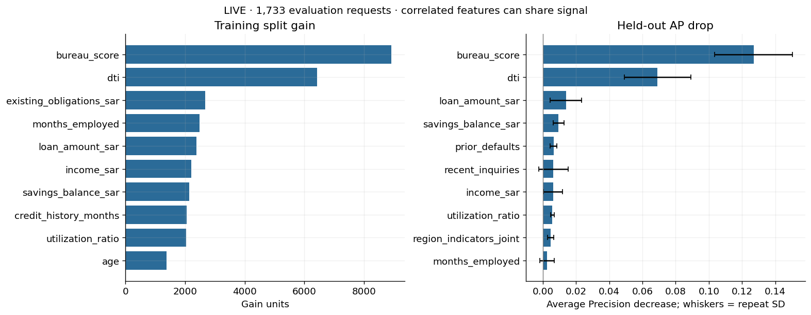
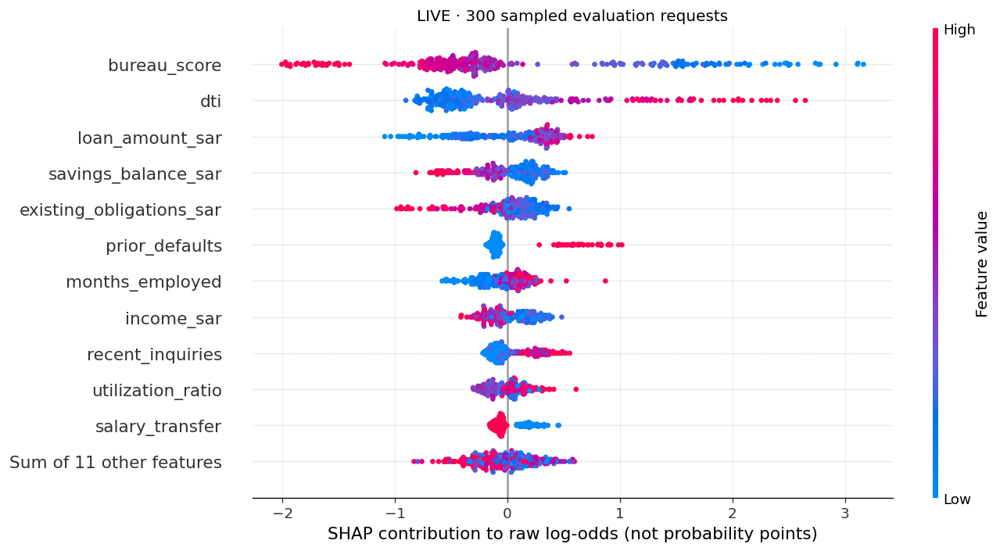
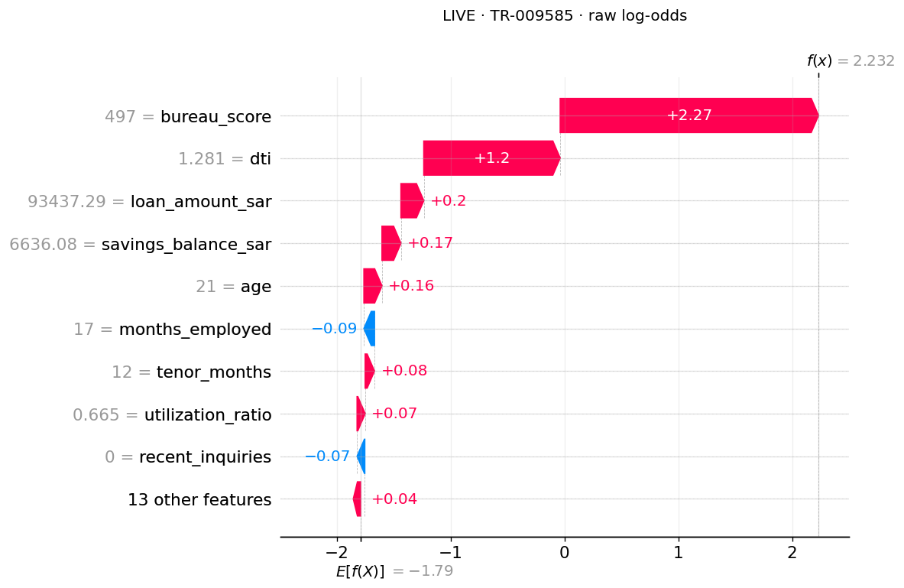
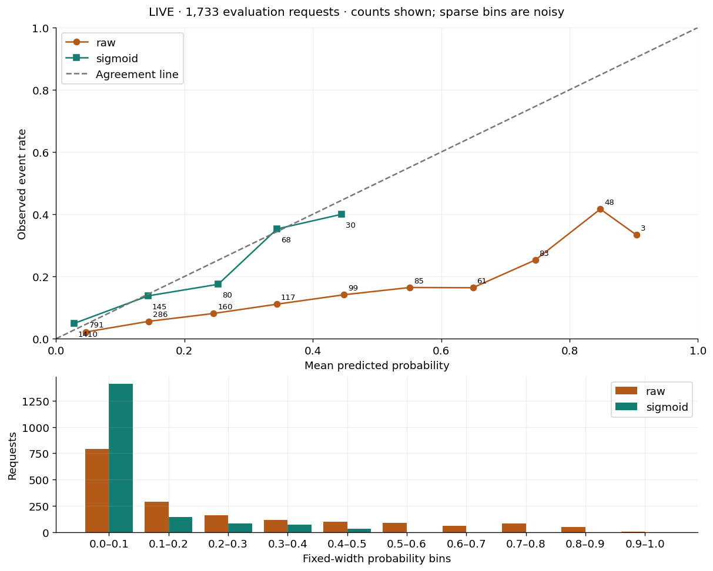
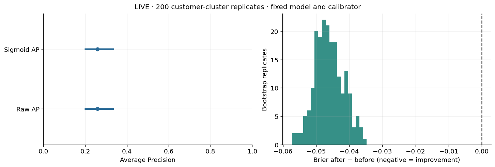
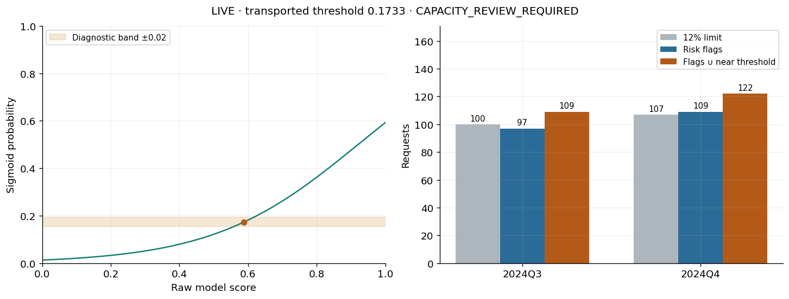

# Tamweel Lite Day 4 technical report

Model interpretation and probability calibration

Review capacity under a fixed operating rule

Author: Aljuhara Alshagri  
Programme: SDAIA Academy, Advanced Machine Learning, SDA-DSC-211  
Report date: 24 November 2026

## 1 Executive findings

Day 4 examined how the fitted Tamweel Lite model uses application information, whether its probabilities agree with observed synthetic defaults, and whether a proposed review queue fits the teaching capacity policy. The saved run contains LIVE explanations, completed reflection answers and a completed export step. It also records a capacity breach that remains unresolved. The statuses describe different aspects of the exercise and must be interpreted separately [1].

On 1,733 evaluation applications containing 139 defaults, sigmoid calibration reduced Brier score from 0.113027 to 0.067112 and log loss from 0.357993 to 0.246749. Expected calibration error decreased from 0.146871 to 0.022486. Average precision remained 0.258677, and ROC-AUC remained 0.770804. These results support better probability estimates on the evaluated applications while showing unchanged ranking performance [1].

Both permutation importance and global SHAP identified bureau score and debt-to-income ratio as the strongest measured inputs. For the selected request, TR-009585, these inputs also supplied the largest positive local contributions. Their SHAP values explain the model's raw log-odds. They are not percentage-point changes in calibrated default probability [1].

The candidate review queue contained 109 applications against capacity for 100 in 2024Q3, and 122 against capacity for 107 in 2024Q4. The resulting status is `CAPACITY_REVIEW_REQUIRED`. Evaluation applications were held out within the Day 4 workflow, but the export explicitly records prior course exposure and states that this is not a final untouched test [1].

## 2 Task and experimental design

The teaching task is to estimate a synthetic default event within 90 days of a loan application. Day 4 uses a weighted LightGBM model, a separate sigmoid calibration stage and a policy threshold chosen before evaluating later applications. The exercise supports inspection of the model and its operating rule; its saved report template states that it is not for real financing decisions [1].

The code deduplicates applications, checks the data contract and assigns separate roles for fitting, calibration, policy selection and evaluation. The role summary records the following cohorts [1].

| Role | Applications | Customers | Defaults | Default rate | First application | Last application |
|---|---:|---:|---:|---:|---|---|
| Fit | 2,516 | 1,853 | 217 | 8.6248% | 2022-01-01 | 2023-04-01 |
| Calibration | 584 | 538 | 40 | 6.8493% | 2023-07-01 | 2023-09-30 |
| Policy | 589 | 566 | 55 | 9.3379% | 2024-01-01 | 2024-03-31 |
| Evaluation | 1,733 | 1,520 | 139 | 8.0208% | 2024-07-01 | 2024-12-31 |

The split excludes 4,578 applications for gaps or customer overlap. The stated design separates roles by time and customer. After fitting the model and calibrator, the workflow chooses the threshold using policy applications, transports it through the calibration mapping, and freezes those components before evaluation. This separation prevents the displayed evaluation results from being used to fit the Day 4 calibrator or choose the original policy threshold [1].

That protection has a defined scope. The export sets both `prior_course_exposure=True` and `not_a_final_untouched_test=True`. The evaluation is therefore a held-out assessment within Day 4, with prior exposure elsewhere in the course. A revised model or policy would need fresh evidence before being described as independently confirmed [1].

The saved environment reports CPU execution, Python 3.13.18, seed 211, two processing jobs and FAST_MODE enabled. Setup pins course and support revisions and verifies file hashes. This report documents the submitted code and saved outputs; preparing it did not rerun model fitting or regenerate predictions [1].

## 3 Global dependence and feature contributions

### Permutation importance

Permutation importance measures the change in evaluation average precision when a feature or feature group is shuffled. A larger positive decrease indicates greater measured dependence on that input for ranking these applications. The comparison with training gain shows how feature use during fitting relates to predictive dependence on the evaluation cohort. The two columns have different units [1].

| Feature or group | Mean AP decrease | Repeat standard deviation | Training gain |
|---|---:|---:|---:|
| bureau_score | 0.1270 | 0.0235 | 8,922.6701 |
| dti | 0.0690 | 0.0200 | 6,423.5164 |
| loan_amount_sar | 0.0140 | 0.0095 | 2,372.2859 |
| savings_balance_sar | 0.0094 | 0.0032 | 2,129.8893 |
| prior_defaults | 0.0065 | 0.0021 | 1,109.2766 |
| recent_inquiries | 0.0064 | 0.0089 | 902.9509 |
| income_sar | 0.0062 | 0.0058 | 2,214.5619 |
| utilization_ratio | 0.0057 | 0.0011 | 2,035.9451 |
| region_indicators_joint | 0.0047 | 0.0020 | 360.9725 |
| months_employed | 0.0025 | 0.0044 | 2,482.2264 |

Bureau score and debt-to-income ratio have substantially larger measured AP decreases than the remaining displayed inputs. Training gain does not reproduce the complete permutation order: months employed has more gain than loan amount but a smaller evaluation AP decrease. Several smaller effects also have appreciable variation across shuffles. These observations support reading the two measures together instead of treating training gain as a complete evaluation result [1].

Figure 1. Saved comparison of training gain and evaluation AP decrease. Whiskers show repeat standard deviation, not confidence intervals. Region indicators are permuted jointly. Source: [1], Day 4 Section 3, execution 35.

### Global SHAP

The LIVE global explanation covers 300 sampled evaluation requests. It averages the absolute SHAP contribution for each feature, so it summarizes contribution magnitude without retaining the direction for an individual request. The leading mean absolute contributions were 0.9042 for bureau score, 0.5437 for debt-to-income ratio and 0.3490 for loan amount, all in raw log-odds units. Savings balance followed at 0.2169 and existing obligations at 0.2022 [1].

The agreement between the leading SHAP and permutation features supports their prominence in this fitted model. The measures still answer different questions: SHAP attributes model output, while permutation measures a ranking loss after disrupting an input. Correlated inputs can share information, so neither ranking identifies an isolated causal effect or the benefit of changing an applicant's circumstances [1].

Figure 2. Saved LIVE SHAP beeswarm. Each displayed contribution is to the raw log-odds output; the global summary describes the sampled requests. Source: [1], Day 4 Section 4, execution 36.

## 4 Local explanation and reason code limits

The local case, TR-009585, was selected as the request with the highest raw margin within the SHAP sample. Selection used the model score, not the observed default outcome. Its raw probability was 0.9031, while its calibrated probability was 0.4795. This difference makes the output scale essential to interpreting its explanation [1].

| Displayed positive reason | Value used | Imputed | SHAP contribution in log-odds |
|---|---:|---|---:|
| bureau_score | 497 | False | +2.269325 |
| dti | 1.2806 | False | +1.198145 |
| loan_amount_sar | 93,437.29 SAR | False | +0.200725 |

All three displayed values were observed. These are the leading positive reasons, not the complete additive decomposition. The waterfall also includes other positive or negative contributions and the baseline. Adding every SHAP value to the baseline reconstructs the raw margin. Applying expit to that total gives the raw probability, after which the separate calibration mapping gives the calibrated probability [1].

The maximum recorded additivity error was approximately 5.7e-15. This establishes numerical agreement between the SHAP decomposition and the explained raw margin. It does not establish that the probability is accurate for this individual. Applying a sigmoid separately to individual SHAP values would also not produce additive probability contributions [1].

Figure 3. Saved local waterfall for the highest-scoring request in the SHAP sample. Its units are raw log-odds. Source: [1], Day 4 Section 5, execution 37.

The reason codes describe associations learned from synthetic data. They do not show that any input causes default, that changing it would change the outcome, or that the model meets a fairness standard. The explanation is useful for inspecting the calculation and checking which supplied values the model used. It cannot establish suitability for real lending decisions [1].

## 5 Probability calibration evidence

The sigmoid calibrator was fitted on its designated role, which contained 584 applications and 40 positives. The following comparison uses the later evaluation role of 1,733 applications and 139 defaults, after the model and calibrator were frozen. Lower Brier score, ECE and log loss support better measured probability performance in this assessment [1].

| Evaluation metric | Raw | Sigmoid calibrated |
|---|---:|---:|
| ROC-AUC | 0.770804 | 0.770804 |
| Average precision | 0.258677 | 0.258677 |
| Brier score | 0.113027 | 0.067112 |
| Expected calibration error | 0.146871 | 0.022486 |
| Log loss | 0.357993 | 0.246749 |

The printed after-minus-before changes are -0.04592 for Brier score and -0.12438 for ECE. Ranking was preserved, as shown by identical AP and ROC-AUC. Calibration therefore improved the measured probability assessment without improving discrimination between defaults and non-defaults in this run [1].

Figure 4. Saved reliability comparison with ten equal-width probability bins. The upper panel compares mean probability with observed event rate; the lower panel shows bin counts. Source: [1], Day 4 Section 6, execution 38.

The counts matter because sparsely populated bins provide imprecise evidence about their score ranges. A lower aggregate calibration error does not establish uniform agreement in every bin. The small calibration cohort and prior course exposure also constrain how far the measured improvement can be generalized. The saved results describe these applications and this frozen mapping [1].

## 6 Sampling and local stability

The saved analysis reports 200 paired customer-cluster bootstrap replicates. Customers are the resampling units, and the model and calibrator stay fixed. The same resampled observations support the before-and-after comparison. The reported 95% percentile intervals are as follows [1].

| Quantity | Lower bound | Upper bound |
|---|---:|---:|
| Raw AP | 0.197442 | 0.337854 |
| Calibrated AP | 0.197442 | 0.337854 |
| Brier change after minus before | -0.054177 | -0.037409 |

The Brier-change interval is entirely negative, supporting the observed improvement under this resampling procedure. The AP interval remains fairly broad. These intervals describe variation in the evaluation sample, conditional on the fitted components. They exclude uncertainty from retraining, refitting calibration and future distribution changes, and they are not uncertainty intervals for an individual applicant's probability [1].

| Period | Applications | Defaults | AP for both variants | Raw Brier | Calibrated Brier | Calibrated ECE |
|---|---:|---:|---:|---:|---:|---:|
| 2024Q3 | 836 | 78 | 0.27457 | 0.11528 | 0.07760 | 0.03229 |
| 2024Q4 | 897 | 61 | 0.27050 | 0.11093 | 0.05734 | 0.02434 |

Quarterly AP values are close, and calibration improves Brier score in both periods. Two quarters provide limited temporal evidence, however. The pooled AP of 0.258677 is calculated over all evaluation requests and should not be replaced by an average of the quarterly AP values [1].

Figure 5. Saved AP intervals and distribution of Brier changes with the model and calibrator fixed. Source: [1], Day 4 Section 7, execution 39.

The local perturbation check changed TR-009585's bureau score from 497 to 496 and 498. Raw probability remained 0.903079, calibrated probability remained 0.479518, and all three leading positive reasons were retained. This supports local stability for those two small perturbations of that request. It does not establish similar behavior across other features, larger changes or all evaluation applications [1].

## 7 Threshold transport and review capacity

The policy rule minimizes the teaching loss `10 * FN + FP` subject to a 12% review capacity limit. The selected raw threshold was approximately 0.588195. On the 589 policy applications, it flagged 68 against capacity for 70, with 34 false negatives, 47 false positives and 387 loss units. The calibrated equivalent was approximately 0.17331. Transporting the threshold keeps the operating boundary consistent with the changed probability scale [1].

The diagnostic review band extends 0.02 on either side of the calibrated threshold, approximately 0.15331-0.19331. It is a proposed near-threshold review rule, not a confidence interval. The candidate queue is the union of risk flags and near-threshold requests, so an application in both groups is counted once [1].

| Period | Capacity | Risk flags | Near threshold | Candidate queue | Excess candidates |
|---|---:|---:|---:|---:|---:|
| 2024Q3 | 100 | 97 | 23 | 109 | 9 |
| 2024Q4 | 107 | 109 | 21 | 122 | 15 |

The band adds 12 applications beyond risk flags in Q3 and 13 in Q4. Simply adding each near-threshold count to its flag count would double-count overlaps. More fundamentally, Q4 already has 109 risk flags against capacity for 107. Removing the band alone would therefore leave a capacity breach at the frozen threshold [1].

Figure 6. Saved threshold mapping, diagnostic review band and quarterly capacity comparison. Both candidate queues exceed their limits. Source: [1], Day 4 Section 8, execution 40.

The recorded outcome is `CAPACITY_REVIEW_REQUIRED`. A subsequent operating rule should be designed using designated development or policy data and assessed on a new held-out period. Retuning against the current evaluation results would weaken its role as evidence. The notebook also cautions against raising the limit or trimming cases after seeing the outcome. Its loss units are teaching quantities, not financial charges [1].

## 8 Completion status and evidence provenance

The saved reflection output is `READY_FOR_REVIEW | Fields to complete: []`. The export output records `TECHNICAL_READY | READY_FOR_REVIEW | LIVE | CPU` and reports 28 files saved in the course evidence archive. These messages document the original notebook execution. The submitted attachment provides the saved tables, figures and export code; it does not itself supply every separate prediction, model or archive file written in that runtime [1].

| Status | Meaning within this submission |
|---|---|
| LIVE | Explanations came from the executed model workflow rather than the educational example fallback. |
| TECHNICAL_READY | The export's technical condition was met for a LIVE explanation source. |
| READY_FOR_REVIEW | All required reflection fields were completed. |
| CAPACITY_REVIEW_REQUIRED | The candidate operating rule exceeded observed review limits. |

Educational completeness does not approve the operating policy or award an automatic grade. The export explicitly records `no_automatic_grade=True`. The report therefore preserves both outcomes: the interpretation exercise is complete for review, and the capacity finding requires further policy work [1].

## Appendix A Reflection answers

### A1 Global and local explanation

Global SHAP summarizes contribution magnitudes across 300 sampled requests; bureau score and dti lead at 0.9042 and 0.5437 log-odds. Permutation AP decreases of 0.1270 and 0.0690 support their measured importance. Local SHAP explains the direction and magnitude of contributions for TR-009585, including +2.2693 from bureau score and +1.1981 from dti [1].

### A2 Output units

SHAP values add to raw log-odds. The sigmoid of the complete margin gives raw probability; a separate calibration mapping gives calibrated probability. TR-009585 changes from raw score 0.9031 to calibrated probability 0.4795. Its SHAP values do not directly decompose the calibrated probability [1].

### A3 Reason code limits

The displayed reasons used observed values of bureau score 497, dti 1.2806 and loan amount 93,437.29 SAR. They describe the fitted synthetic model's behavior. Correlation can affect attribution, and the reasons establish neither causality nor fairness or suitability for real lending [1].

### A4 Calibration evidence

Calibration reduced Brier score to 0.067112, ECE to 0.022486 and log loss to 0.246749 on the Day 4 evaluation role. AP and ROC-AUC were unchanged. This supports improved measured probability agreement, subject to sparse-bin uncertainty and the recorded prior course exposure [1].

### A5 Stability

The paired bootstrap Brier-change interval was [-0.054177, -0.037409], while both AP intervals were [0.197442, 0.337854]. These are conditional on fixed fitted components. The local bureau-score perturbations preserved probabilities and leading reasons, but establish stability only for the checked changes [1].

### A6 Review capacity

The transported threshold was 0.17331. Candidate review counts of 109 and 122 exceeded quarterly capacities of 100 and 107. Q4 risk flags alone also exceeded capacity. The status remains `CAPACITY_REVIEW_REQUIRED`; any revised rule needs development on appropriate data and assessment using fresh evidence [1].

## Reference

[1] A. Alshagri, [Tamweel Lite capstone notebook](../notebooks/Tamweel_aljuharaalshagri.ipynb), submitted Tamweel Lite capstone notebook, SDAIA Academy, Advanced Machine Learning, SDA-DSC-211. Day 4, Sections 1-10, saved execution counts 33-42. Source reviewed for this report on 24 November 2026.
