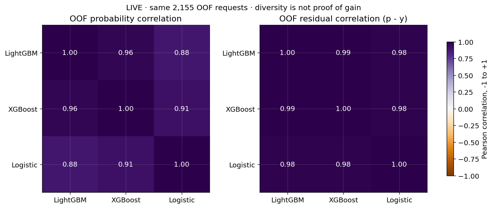
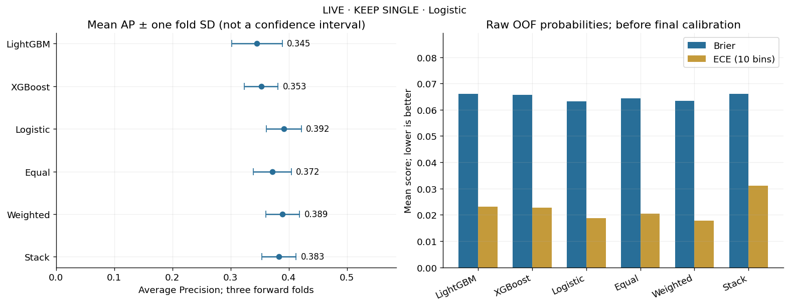
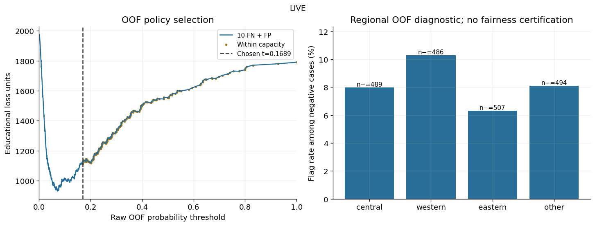
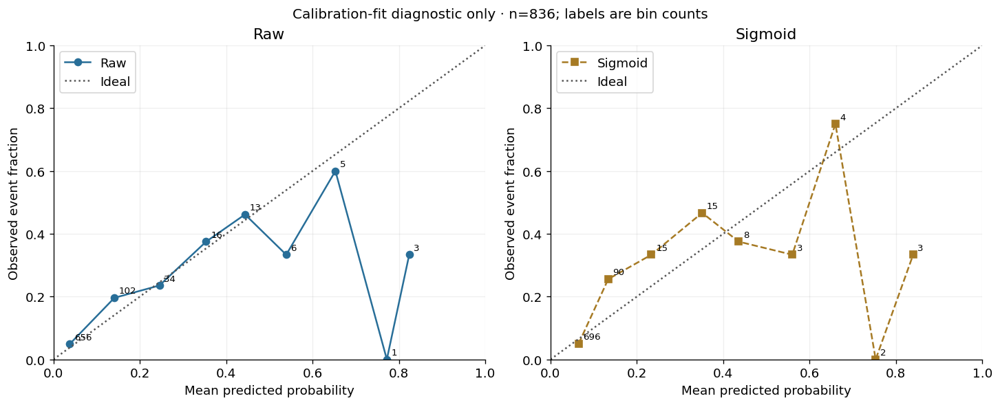
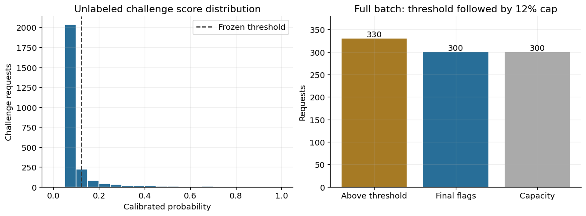

# Tamweel Lite Day 5 technical report

Aljuhara Alshagri  
SDAIA Academy Advanced Machine Learning SDA-DSC-211  
25 November 2026

Evidence checked against repository snapshot [52bb4bf3071251974569553f7ff4971eacd0f844](https://github.com/aljuharaalshagri/Tamweel_SDAIA_AdvanceML/tree/52bb4bf3071251974569553f7ff4971eacd0f844). The source review covers the saved notebook and repository artifacts. Training and prediction were not rerun for this update.

## 1 Executive decision

I selected the single Logistic Regression model for the final Tamweel Lite training project. It achieved the highest mean Average Precision (AP) across three forward validation folds, 0.39166, with a fold standard deviation of 0.02981. The strongest ensemble by AP, the weighted ensemble, scored 0.38942. Its slightly lower variability and expected calibration error did not come with a ranking improvement, and no ensemble passed the notebook's worth-it gate. Maintaining one model therefore fits the measured results and avoids the additional components required for blending or stacking. [N100]

The final batch policy retained 300 review flags from 2,500 challenge requests, exactly the 12% capacity limit. It removed 30 of the 330 requests above the frozen threshold. This demonstrates the observed operation of the batch cap; the challenge has no outcomes from which to estimate predictive accuracy, recall or fairness. [N106]

The probability assessment requires further work. Sigmoid calibration increased Brier score from 0.076473 to 0.078058 and also worsened log loss and ECE on the calibration-fit cohort. Those rows were separate from classifier fitting, but they were also used to fit the calibration mapping. Independent calibration evaluation and explanations for the final Logistic model remain necessary. The project is restricted to fictional training with synthetic applications. [N104]

## 2 Task and data roles

Tamweel Lite estimates the risk of a simulated default within 90 days of a loan application. The prediction uses information available at submission time. The subsequent policy allocates a limited review queue; a model score and a review decision are separate outputs. The exercise combines ranking evaluation, probability diagnostics and a capacity-constrained decision rule. [N1, N52]

Day 5 partitions the 10,000 training applications into a fitting and selection pool, a later calibration cohort, and excluded rows. The role summary records the following composition. [N94]

| Role | Rows | Customers | Positives | Application dates |
| --- | ---: | ---: | ---: | --- |
| Fit and selection | 6,576 | 3,931 | 537 | 2022-01-01 to 2024-04-01 |
| Calibration only | 836 | 788 | 78 | 2024-07-01 to 2024-09-30 |
| Excluded | 2,588 | Not reported | Not reported | Not reported |

Chronology, separation of customers and availability of mature 90-day labels are the validation constraints carried through the course. An application cannot contribute a known training outcome before its observation window closes. The final notebook also explicitly asserts that training and challenge customers do not overlap. The displayed exclusion total should not be interpreted as a count of one specific exclusion reason because the role summary does not break it down. [N32, N94]

The calibration cohort contains 78 positives among 836 applications, a prevalence of 9.33%. The selected OOF policy is evaluated on 2,155 applications containing 179 positives and 1,976 negatives. These are different cohorts with different roles, so their metrics are not interchangeable. [N102, N104]

## 3 Candidate procedures and forward validation

The comparison includes three individual models, LightGBM, XGBoost and Logistic Regression, and three combination procedures, Equal, Weighted and Stack. Equal represents an average of model predictions, Weighted a weighted combination, and Stack a second-stage combination model. The decision is whether the observed benefit of combining predictions warrants the extra fitted components. [N96, N100]

The notebook records 2,155 LIVE OOF predictions across three outer periods: January-March 2023, July-September 2023 and January-March 2024, with 732, 734 and 689 validation applications. Warm-up rows do not receive outer OOF predictions. Within each outer training set, inner forward OOF predictions supply the data for choosing weighted-average settings from a 12-point grid and fitting the Logistic stacking model. The outer validation outcomes are then used to score all six candidates. Both levels enforce chronological training, mature 90-day outcomes and customer separation. This protects each outer comparison from fitting the combination directly on its validation outcomes. [N96; OOF provenance](../artifacts/artifacts_Day5/day5_oof_provenance.json) and [implementation](../scripts/day5_final.py).

Outer OOF predictions are still development evidence. Day 5 uses them to choose the final candidate and then select its decision threshold. Consequently, the selected model and policy do not have an untouched final performance estimate in this record. Three periods also provide limited information about temporal variation. Fold standard deviation describes variation among those periods; it is not a confidence interval or a significance test. Previous course exposure and the synthetic nature of the data further limit transfer to new settings. [N88, N96, N100, N102]

The diversity plots compare both probabilities and residuals, calculated as prediction minus outcome. The displayed probability correlations are 0.96 for LightGBM with XGBoost, 0.88 for LightGBM with Logistic, and 0.91 for XGBoost with Logistic. Residual correlations are 0.99, 0.98 and 0.98, respectively. These are rounded figure labels; the [probability correlation table](../artifacts/artifacts_Day5/day5_probability_correlation.csv) and [residual correlation table](../artifacts/artifacts_Day5/day5_residual_correlation.csv) retain full precision. They suggest substantial shared error patterns, but correlation alone cannot establish whether an ensemble improves AP. [N98]

Figure 1. Probability and residual correlations for the three individual models. Values are displayed to two decimal places. [N98]

## 4 Model comparison and selection rationale

The table reports the notebook's mean fold scores for raw OOF probabilities, before final sigmoid calibration. AP measures ranking across score thresholds; higher values are preferred. Brier score measures squared probability error, while ECE summarizes the gap between predicted and observed frequencies within bins. Lower Brier and ECE are preferred, although Brier also reflects aspects of prediction quality beyond calibration. [N100]

| Candidate | Mean AP | Fold SD | Mean Brier | Mean ECE | AP change from Logistic |
| --- | ---: | ---: | ---: | ---: | ---: |
| LightGBM | 0.34549 | 0.04348 | 0.06608 | 0.02311 | -0.04617 |
| XGBoost | 0.35263 | 0.02904 | 0.06566 | 0.02276 | -0.03903 |
| Logistic | 0.39166 | 0.02981 | 0.06327 | 0.01882 | 0.00000 |
| Equal | 0.37170 | 0.03258 | 0.06435 | 0.02038 | -0.01996 |
| Weighted | 0.38942 | 0.02906 | 0.06332 | 0.01772 | -0.00224 |
| Stack | 0.38314 | 0.02949 | 0.06603 | 0.03106 | -0.00852 |

The weighted ensemble is the closest alternative. Its AP is lower by 0.00224 and its Brier score is slightly higher. It has lower fold SD by 0.00075 and lower ECE by 0.00110. These are small descriptive differences. They do not establish statistical superiority for either procedure, and they do not demonstrate an AP benefit from combining models. Equal averaging and stacking also remain below Logistic on mean AP. [N100]

The implemented gate requires an ensemble's AP lift to exceed the best single model's fold SD, 0.029808482193007513. Its mean Brier may increase by at most 0.005 and mean ECE by at most 0.01. Passing ensembles are considered in the fixed order Equal, Weighted, Stack; if none pass, the best single model is retained. Every ensemble had a negative AP change, so none met the AP condition. The fold-SD rule is a practical selection rule, not a significance test. [Recorded gate](../artifacts/artifacts_Day5/day5_ensemble_gate.json) and [implementation](../scripts/day5_final.py).

The gate returned KEEP SINGLE with Logistic as the chosen candidate. The exported prediction procedure uses the Logistic classifier with its preprocessing and frozen sigmoid mapping. The comparison and final-fitting code still fit all base candidates internally; the simpler exported prediction procedure has fewer model components to explain and maintain. This decision follows this run's AP objective and evidence. A different dataset, time period or independently evaluated combination could change the choice. [N100, N104; exported model](../artifacts/final_model/model.json)

Figure 2. AP with one fold SD and mean raw-probability scores. Error bars are descriptive fold variation. [N100]

## 5 OOF threshold and teaching loss

The selected Logistic OOF predictions were passed through a threshold sweep under the teaching loss 10 times false negatives plus false positives. The selected raw threshold is approximately 0.168922. It flags 245 of 2,155 applications, or 11.37%, and the largest period flag fraction is 11.75%, below the 12% limit. [N102]

| Actual outcome | Flagged for review | Not flagged |
| --- | ---: | ---: |
| Default | 84 true positives | 95 false negatives |
| No default | 161 false positives | 1,815 true negatives |

Recall is 84 divided by 179, or 46.93%: the proportion of actual defaults flagged. Precision is 84 divided by 245, or 34.29%: the proportion of flags associated with an actual default. The false-positive rate is 161 divided by 1,976, or 8.15%: the proportion of actual negatives flagged. Accuracy is 1,899 divided by 2,155, or 88.12%. [N102]

Accuracy alone would give a misleading policy comparison. A hypothetical all-negative rule would classify 1,976 of these applications correctly, or 91.69%, while identifying none of the 179 defaults. This calculation follows directly from the reported class counts and is not a separate fitted-model result. The chosen rule trades more false positives for detection of some defaults under the specified loss and workload constraints.

The chosen rule incurs 10 times 95 plus 161, equal to 1,111 teaching loss units. Sensitivity analysis changes the false-negative cost while keeping this same threshold and the same confusion counts. It does not optimize three new policies. [N102]

| False-negative cost | False-positive cost | Loss at the fixed threshold |
| ---: | ---: | ---: |
| 8 | 1 | 921 |
| 10 | 1 | 1,111 |
| 12 | 1 | 1,301 |

Figure 3. The threshold sweep and regional OOF diagnostics at the selected raw threshold. [N102]

## 6 Final fitting and calibration diagnostics

The chosen procedure is refitted using the 6,576-row pool, and a sigmoid mapping is fitted using the separate 836-row calibration cohort. The notebook transports the raw threshold through that mapping to 0.12225843144286948. This is a change of probability scale, not a new threshold search using calibration outcomes. [N94, N104]

| Metric | Raw probabilities | After sigmoid |
| --- | ---: | ---: |
| AP | 0.287803 | 0.287803 |
| ROC-AUC | 0.789037 | 0.789037 |
| Brier score | 0.076473 | 0.078058 |
| Log loss | 0.266489 | 0.277296 |
| ECE | 0.021121 | 0.034871 |

All three probability-error metrics worsen after sigmoid. Ranking metrics remain unchanged. The run therefore does not support a claim that calibration improved the final model. Its AP of 0.287803 also should not be treated as directly comparable with the earlier mean fold AP of 0.39166: the cohort, fitted procedure and aggregation differ. [N100, N104]

The calibration rows were held out from fitting the classifier, but the mapping's diagnostics were computed on those same calibration-fit rows. They cannot establish how well the mapping generalizes. The reliability plots use 10 fixed-width bins with counts beside the occupied bins; a small bin count limits the precision of its observed rate. The next evaluation should freeze the fitted procedure and assess raw and mapped probabilities on a separate later cohort with mature labels. Any decision to change calibration needs development data and a fresh assessment period. [N104]

Figure 4. Calibration-fit diagnostics for 836 applications and 78 positives. These curves are not an independent calibration test. [N104]

## 7 Challenge inference and the complete batch cap

The notebook scores all challenge requests with the exported procedure and applies the capacity policy once to the complete batch. The batch results are recorded below. The assertion in the inference cell compares exported-inference probabilities with the direct fitted-model and mapping calculation at an absolute tolerance of 0.000000000001. The saved cell completes without a displayed assertion error. [N106]

| Batch measure | Observed value |
| --- | ---: |
| Requests scored | 2,500 |
| Capacity at 12% | 300 |
| Requests above the transported threshold | 330 |
| Final review flags | 300 |
| Flags removed by the cap | 30 |
| Boundary probability | 0.12990841067105013 |

The saved audit specifies thresholding first, followed by a full-batch cap in descending probability order. It retains entire equal-score blocks and drops the boundary block if that block cannot fit. It uses neither labels nor application IDs to break ties. This rule can leave capacity unused for some batches, although all 300 places were filled in this run. [N106]

Threshold eligibility was 13.2%; final flags were 12%. The 30 removed requests remain threshold-eligible cases that could not be retained under the cap. They are not known false positives. Applying the cap separately to arbitrary chunks could produce a different selection, so inference must preserve the complete-batch policy. Regional effects also need inspection after this selection step. [N106]

Figure 5. Unlabeled challenge scores and the reduction from 330 eligible requests to 300 final flags. [N106]

## 8 Regional diagnostics and their limits

Regional outcome diagnostics use the selected OOF threshold. FPR has actual negative cases as its denominator; recall has actual positive cases as its denominator. Neither rate divides by all regional applications. [N102]

| Region | Rows | Negative cases | Positive cases | FPR | Recall |
| --- | ---: | ---: | ---: | ---: | ---: |
| Central | 537 | 489 | 48 | 39/489 = 7.98% | 24/48 = 50.00% |
| Western | 533 | 486 | 47 | 50/486 = 10.29% | 21/47 = 44.68% |
| Eastern | 542 | 507 | 35 | 32/507 = 6.31% | 16/35 = 45.71% |
| Other | 543 | 494 | 49 | 40/494 = 8.10% | 23/49 = 46.94% |

The largest observed FPR gap is approximately 3.98 percentage points between western and eastern applications. The low-negative-support flag is false in every region, but positive counts range only from 35 to 49. This constrains the precision of recall comparisons. The table supplies descriptive evidence about this OOF cohort, not a fairness certification or a causal explanation of regional differences. [N102]

These rates also precede the challenge batch cap. Capacity compliance cannot establish regional fairness, and unlabeled challenge data cannot supply post-cap FPR or recall. Immediately observable checks include score distributions, selection fractions and removed flags by region. Outcome-based checks require mature labels and should report denominators and uncertainty.

## 9 Explanation scope and required rechecks

Day 4 explains a weighted LightGBM fitted on 2,516 applications, using a 300-request SHAP sample. Its SHAP values describe raw log-odds. Day 5 chooses Logistic Regression and refits it on a different, larger pool. The earlier feature rankings, waterfall plot and reason codes therefore cannot serve as explanations of the final fitted model. The earlier calibration improvement also cannot be transferred to the Day 5 procedure. [N72, N76, N88, N94, N100, N104]

The final Logistic pipeline needs an appropriate explanation method that includes its actual preprocessing and reference background. Rechecks should verify output units and additivity, identify imputed values, examine local reason codes and small-input stability, and reassess permutation importance on suitable held-out data. A score explanation must be distinguished from the additional decision created by the sigmoid mapping, threshold and batch cap. Removing a threshold-eligible case for capacity reasons is a policy action, not a feature contribution. Explanations describe model associations; they do not establish causality or fairness.

## 10 Monitoring and intended use

For each new batch, monitoring should check schema compliance, feature availability, missingness, duplicate application IDs, feature distributions and score drift. The operational record should retain total requests, threshold eligibility, final flags, equal-score boundary handling and cap removals. Selection and removal rates should be compared by region, with the 12% limit checked over the complete batch.

Once 90-day outcomes mature, the review should measure default prevalence, AP, precision, recall, teaching loss, Brier, log loss, ECE and reliability-bin counts. Regional outcome checks should include their positive and negative denominators and uncertainty. A sustained change should trigger investigation of data quality, population change, probability quality and workload. Proposed revisions should be developed on designated data and assessed on a fresh later cohort. Refitting the model also requires updated explanations.

The artifact is for coursework and reproducible experimentation with fictional applications. The loss weights and capacity limit are teaching assumptions. It must not be used for real loan approval or rejection, loan pricing, credit-limit decisions or customer-facing adverse-action reasons. The observed results do not establish production readiness. [N52, N88]

## 11 Reproduction and evidence record

The recorded run uses Python 3.13.18 on CPU with seed 211, two jobs and FAST_MODE enabled. Package versions include NumPy 2.1.3, pandas 2.2.3, scikit-learn 1.6.1, XGBoost 3.4.1 and LightGBM 4.6.0. Its saved configuration sets 80 trees and a 120-second budget for each budgeted comparison or fitting call. The setup pins the course revision and Day 5 support revision and verifies source-file hashes. [N92, N94; run record](../artifacts/artifacts_Day5/day5_run.json) and [environment](../artifacts/artifacts_Day5/environment.json).

The current repository contains the [fitted Logistic artifact](../artifacts/final_model/model.json), [model manifest](../artifacts/final_model/model_manifest.json), [calibration mapping and batch policy](../artifacts/final_policy.json), [full OOF predictions](../artifacts/artifacts_Day5/day5_oof_predictions.csv) and [2,500-row challenge submission](../submission/submission.csv). The [inference entry point](../scripts/inference.py), [replay script](../scripts/replay_final.py) and [rebuild script](../scripts/rebuild_final.py) are also present. The inference script reads the root-level model directory by default; the Gate 5 archive contains another copy under `artifacts/artifacts_Day5/final_model/`.

The saved notebook records completion of the reflection and export cells. Execution 51 returns `READY_FOR_REVIEW` with no missing response fields. Execution 52 reports `REPLAY_MATCH` and `BUNDLE_BYTES_VERIFIED` for a 48-file bundle, alongside `PROJECT_WORK_REQUIRED`. Replay compares every saved challenge probability at an absolute tolerance of 1e-12 and requires identical full-batch decisions. These are recorded course-runtime results. They were not rerun for this documentation update. [N108, N110]

| Recorded check | Result | Interpretation |
| --- | --- | --- |
| [Technical run](../artifacts/artifacts_Day5/day5_run.json) | `TECHNICAL_READY`, `LIVE`, `KEEP SINGLE`, `Logistic` | The recorded comparison, fitting and export completed. |
| [Reflection checkpoint](../artifacts/artifacts_Day5/day5_reflection.json) | `READY_FOR_REVIEW`, no missing fields | The nine responses are present; their quality still needs human review. |
| Notebook bundle verification | `REPLAY_MATCH`, `BUNDLE_BYTES_VERIFIED`, 48 files | The course runtime recorded matching predictions and verified the exported bundle bytes. [N110] |
| [Bundle completeness check](../artifacts/artifacts_Day5/day5_project_check.json) | `PROJECT_WORK_REQUIRED`, receipt `false` | The earlier bundle workflow did not find all of its expected evidence and deliverable paths. |
| [Later repository self-check](../tamweel_lite_self_check.json) | `NEEDS_WORK`, 13 findings, 0 manual notes | Eight distinct expected paths are absent; five also fail an executed-notebook check. [N114, N116] |

The earlier bundle check expects imported learner evidence under `evidence/day1` through `evidence/day4`, five separately named notebooks, and `presentation/final_presentation.pdf`. It reports those items as missing. The repository contains earlier daily artifacts and the combined executed notebook, so these findings describe that checker's expected layout and packaging. They do not establish that the earlier work was never completed. [N110; bundle completeness record](../artifacts/artifacts_Day5/day5_project_check.json)

The later repository checker uses a different list of required files and explicitly excludes the legacy presentation workflow. Its 13 findings cover these eight absent paths:

- `tamweel/__init__.py`
- `tamweel/inference.py`
- `notebooks/01_baseline_boosting.ipynb`
- `notebooks/02_validation_tuning.ipynb`
- `notebooks/03_cost_sensitive_decision.ipynb`
- `notebooks/04_explain_calibrate.ipynb`
- `notebooks/05_final_model.ipynb`
- `notebooks/99_final_submission_check.ipynb`

The additional five findings are execution checks for the missing notebooks numbered 01-05. The existing combined notebook and `scripts/inference.py` do not satisfy those separate path checks. The latest saved checker does not list a presentation requirement. Neither checker supplies an automatic grade or proof of submission. [N114, N116; self-check record](../tamweel_lite_self_check.json)

Source markers identify zero-based cell indices in the current 117-cell [combined notebook](../notebooks/Tamweel_aljuharaalshagri.ipynb) at the repository snapshot cited above. They are cell positions, not execution counts. The report's numerical tables preserve the saved results; proposed calibration, explanation and later-period evaluations remain follow-up work.

| Marker | Notebook evidence |
| --- | --- |
| N1 | Capstone task and prediction timing |
| N32 | Forward folds and mature-outcome requirements |
| N52 | Teaching loss and capacity policy |
| N72 and N76 | Day 4 model roles and SHAP scope |
| N88 | Day 4 report and prior evaluation exposure |
| N92 and N94 | Environment verification and final data roles |
| N96 and N98 | LIVE OOF coverage and diversity figures |
| N100 | Six-candidate scores and selection gate |
| N102 | OOF threshold, confusion counts and regional audit |
| N104 | Final calibration diagnostics and threshold transport |
| N106 | Challenge inference, full-batch cap and tie policy |
| N108 | Completed reflection, execution 51 |
| N110 | Model and submission evidence export, replay, bundle and completeness checks, execution 52 |
| N114 and N116 | Later repository-checker definition and saved `NEEDS_WORK` result |

## 12 الملخص التنفيذي

أختار الانحدار اللوجستي للمشروع التدريبي؛ فقد حقق أعلى متوسط AP بقيمة 0.39166 وانحراف معياري بين الطيات 0.02981، مقابل AP قدره 0.38942 للتجميع الموزون. لم يبرر التجميع زيادة التعقيد. طُبق سقف المراجعة بنسبة 12% على 2500 طلب، فبقيت 300 إشارة من أصل 330 فوق العتبة. تدهور Brier بعد المعايرة من 0.076473 إلى 0.078058، لذلك يلزم تقييم مستقل للمعايرة وإعادة تفسير النموذج النهائي. الاستخدام تعليمي ببيانات اصطناعية، ولا يشمل قرارات تمويل حقيقية. [N100, N104, N106]
